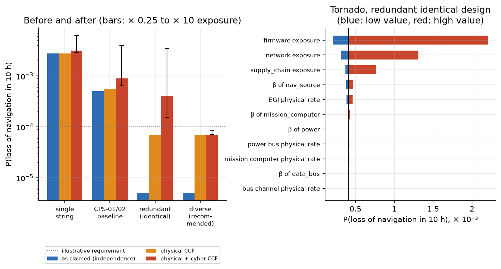

# Redundancy that one cyber attack can defeat

[](https://github.com/GMCavalheri/common-cause-cyber-failure-redundancy/actions/workflows/ci.yml)

Redundancy is the reliability engineer's most trusted tool, and its benefit rests on one word:
the redundant channels fail *independently*. Classical common-cause failure (CCF) models
already correct that word for shared **physical** causes, such as one power supply feeding two
"redundant" units. This repository extends the correction to shared **cyber** vulnerabilities:
two channels running the same firmware image, on the same network segment, from the same
supplier, can be defeated by one attack. It quantifies how much of the benefit claimed for
redundancy survives, and what design diversity buys back.

The core is `cyberccf`, a typed Python package (NumPy, SciPy) with an exact binary-decision-diagram
engine, the NUREG/CR-5485 CCF models, a cyber beta factor with proofs, a cost and diversity
trade-off, an exact Markov model with repair, Monte Carlo oracles, a NIST SP 800-82r3 posture
rubric, and an eight-lesson course that derives every method from first principles.



## Headline results (synthetic system, stated assumptions)

The system is the generic navigation chain of
[CPS-01](https://github.com/GMCavalheri/cyber-attack-reliability-impact-modeling) and
[CPS-02](https://github.com/GMCavalheri/cyber-physical-rbd-attack-trees): two embedded GNSS/INS
units, two power buses, a dual-channel data bus and one or two mission computers. Failure rates,
beta factors, cyber exposures and costs are illustrative and labelled; the cyber exposures have
no field-data basis, so every conclusion is shown across a 40-fold range. Every number is
reproduced by `validation/run_all.py`, and CI fails if one changes.

| question | answer | where |
|---|---|---|
| What does redundancy buy, as usually claimed? | Single string to two EGIs, two bus channels and two identical computers: P(loss of navigation) per 10-hour mission falls 549-fold (2.74 orders of magnitude) | [Lesson 1](docs/lessons/01-the-independence-assumption.md) |
| With physical common cause? | 40-fold (1.60 orders); no number of identical units goes below the floor $1 - e^{-\beta\lambda t}$ | [Lesson 2](docs/lessons/02-when-one-cause-breaks-two-channels.md) |
| With shared cyber vulnerabilities too? | 7.7-fold (0.88 orders) at the illustrative exposure, 1.8-fold at ten times; cyber events carry 83 % of the order-one cut sets | [Lessons 3](docs/lessons/03-the-cyber-beta-factor.md), [5](docs/lessons/05-redundancy-as-claimed-vs-as-it-is.md) |
| How does the correction enter a standard calculation? | As an effective beta factor $1 - \beta = (1-\beta_p)(1-\beta_c)$; the best identical redundancy can buy is a factor $1/\beta$ (proved) | [derivation](docs/derivation.md) |
| What is the largest uncertainty? | The three cyber exposures out-swing every physical rate and beta factor by an order of magnitude or more | [Lesson 5](docs/lessons/05-redundancy-as-claimed-vs-as-it-is.md) |
| What fixes it? | Diversifying each pair in firmware, segment and supplier keeps the physical-CCF figure ($7.1 \times 10^{-5}$) and stays within $7.0$ to $8.5 \times 10^{-5}$ over the whole exposure range; diversity never hurts a redundant group (proved) | [Lessons 3](docs/lessons/03-the-cyber-beta-factor.md), [4](docs/lessons/04-buying-independence.md) |
| What is worth buying first? | With any non-zero exposure, splitting network segments; a third identical unit is the worst buy | [Lesson 4](docs/lessons/04-buying-independence.md) |
| In CPS-01's units, with repair? | The redundant design's MTBF: 2 959 000 h as claimed, 146 500 h with physical CCF, 24 490 h with cyber CCF; diverse: 145 100 h | [Lesson 6](docs/lessons/06-time-repair-and-a-simulation-that-checks-the-algebra.md) |
| Can a NIST OT security posture substitute? | No: controls lower the exposure but none changes which channels share it (SC-29 heterogeneity is in no baseline); the identical design misses an illustrative $10^{-4}$ requirement at every overlay level in the worst case | [Lesson 7](docs/lessons/07-from-a-security-posture-to-a-number.md) |

The full write-up is the [report](docs/report.md); what is and is not new is in
[related work](docs/related-work.md).

## What is in it

| module | what it does |
|---|---|
| [`independence_baseline`](src/cyberccf/independence_baseline/) | block diagrams, basic events, exact quantification by BDD, minimal cut sets, the navigation system |
| [`physical_ccf_beta_factor`](src/cyberccf/physical_ccf_beta_factor/) | beta factor, MGL and alpha factor (NUREG/CR-5485), CCF groups as shared events |
| [`cyber_ccf_model`](src/cyberccf/cyber_ccf_model/) | attribute-defined shared-vulnerability events, the cyber beta factor, closed forms |
| [`architecture_diversity_tradeoff`](src/cyberccf/architecture_diversity_tradeoff/) | 315 designs, costs, Pareto fronts across the exposure range |
| [`case_study_application`](src/cyberccf/case_study_application/) | three views of a design, tornado, robust recommendation |
| [`time_dependent`](src/cyberccf/time_dependent/) | exact Markov availability and MTBF with repair; Monte Carlo oracles |
| [`security_posture`](src/cyberccf/security_posture/) | NIST SP 800-82r3 OT overlay to a range of exposure |

## Quickstart

```bash
git clone https://github.com/GMCavalheri/common-cause-cyber-failure-redundancy
cd common-cause-cyber-failure-redundancy
uv sync
uv run python validation/run_all.py      # every table and figure
uv run pytest --cov                      # the test suite
```

```python
from cyberccf.cyber_ccf_model import cyber_beta, cyber_ccf_model
from cyberccf.independence_baseline import MISSION_HOURS, navigation_model, unreliability
from cyberccf.physical_ccf_beta_factor import physical_ccf_model

for label, model in [
    ("as claimed", navigation_model(mission_computers=2)),
    ("physical CCF", physical_ccf_model(mission_computers=2)),
    ("physical + cyber CCF", cyber_ccf_model(mission_computers=2)),
]:
    print(f"{label:22s} {unreliability(model, MISSION_HOURS):.3e}")
print(cyber_beta(cyber_ccf_model(mission_computers=2), "egi_1"))
# as claimed             5.089e-06
# physical CCF           6.986e-05
# physical + cyber CCF   4.098e-04
# 0.0783...
```

## Documentation

* **Course:** [`docs/lessons/`](docs/lessons/README.md), eight lessons with derivations, worked
  examples and exercises with solutions, and one executed notebook per lesson in
  [`notebooks/`](notebooks/).
* **Derivation:** [`docs/derivation.md`](docs/derivation.md), the formal model and eight
  propositions with proofs, each checked numerically by
  [`validation/reduction_checks.py`](validation/reduction_checks.py).
* **Theory notes:** one per module in [`docs/`](docs/).
* **Report:** [`docs/report.md`](docs/report.md). **Related work:**
  [`docs/related-work.md`](docs/related-work.md). **Scope:** [`docs/scope.md`](docs/scope.md).
* **Results:** [`validation/results/`](validation/results/), regenerated by the scripts in
  [`validation/`](validation/).

## Engineering

* 282 tests (pytest + Hypothesis), 99.8 % branch coverage with a 90 % gate. Every test asserts
  against a closed form, a published value (NUREG/CR-5485 Eqs. 5.5-5.11 and Tables 5-4 and 5-5;
  NIST SP 800-82r3 Table 22) or an independent oracle: CPS-01's `cyberrel` and CPS-02's `cpsrbd`
  v1.0.0 for the shared system, brute-force enumeration, exhaustive BDD truth tables, a Markov
  chain's matrix exponential against the BDD, and Monte Carlo within its own 99.7 % interval.
  Property tests check that common cause never improves a redundant group, that diversifying never
  hurts, and that more exposure never helps.
* `ruff`, strict `mypy`, CI on Python 3.11–3.13, gitleaks and pip-audit, Dependabot.
* A `reproduce` CI job reruns every validation script, fails if any committed table changes, and
  executes every notebook. Rounding-level errors are reported as bounds so that results reproduce
  byte for byte on any CPU; Monte Carlo uses seeded generators.
* **Not included, on purpose:** this is a library and a course, not a deployed service, so there is
  no staging environment, observability stack or feature-flag service.

## Deviations from the plan

* The plan proposed reusing the block-diagram code of an earlier "Avionics Electronics Reliability"
  project. It was never built, and neither CPS-01 nor CPS-02 supports common-cause groups, so the
  CCF-aware engine lives in this package and the planned `external/` folder is dropped. CPS-01
  and CPS-02 are used instead as independent oracles in the tests.
* A variant with two mission computers (already in CPS-01) is used throughout: with one computer,
  a single point of failure hides every redundancy question.
* Added beyond the plan: the alpha-factor and MGL models, availability and MTBF with repair, Monte
  Carlo oracles, and a formal derivation as groundwork for a paper. The plan's first extension
  (NIST SP 800-82 posture) is built in; its second (a CCF node type in CPS-02's unified graph) is
  left as future work.

## Licence

MIT. See [LICENSE](LICENSE).
