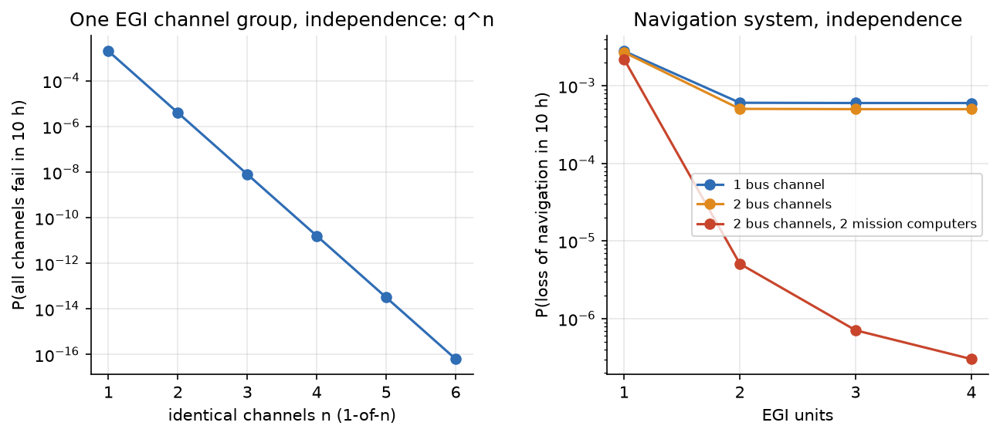

# Lesson 1 · The independence assumption

> Two navigation units that each fail once in 5 000 hours give a pair that, on paper, fails
> together once in about 250 000 ten-hour missions. That number rests on a single word, *independently*.
> This lesson builds the classical reliability calculation that uses the word, on the
> navigation system of the CPS series, so that the rest of the course can measure what
> happens when the word stops being true.

**Code:** [`src/cyberccf/independence_baseline/`](../../src/cyberccf/independence_baseline/) ·
**Data:** [`system_parameters.csv`](../../src/cyberccf/data/system_parameters.csv) ·
**Tests:** [`tests/test_independence.py`](../../tests/test_independence.py),
[`tests/test_crosscheck.py`](../../tests/test_crosscheck.py) ·
**Results:** [`validation/results/independence.md`](../../validation/results/independence.md) ·
**Scope:** [`docs/scope.md`](../scope.md)

## Learning objectives

By the end of this lesson you should be able to:

1. Write the structure function of a series, parallel or k-out-of-n system and its
   reliability under independence.
2. Turn a constant failure rate into a mission failure probability.
3. Explain why a component that appears twice in a block diagram breaks the bottom-up
   formulas, and compute the exact answer by factoring (pivotal decomposition).
4. Find the minimal cut sets of a system and use them to say what dominates its
   unreliability.
5. State precisely what "redundancy reduces failure probability from q to q squared" assumes.

---

## 1. Why redundancy works, on paper

A channel that fails with probability $q$ during a mission is replaced by two identical
channels, either of which is enough. The pair fails only if both fail. If the two failures
are **independent** events,

```math
P(\text{both fail}) = P(A_1 \cap A_2) = P(A_1)\,P(A_2) = q^2 .
```

For an embedded GNSS/INS unit (EGI) with a failure rate of $2 \times 10^{-4}$ per hour, a
10-hour mission gives $q \approx 2.0 \times 10^{-3}$ and the pair $q^2 \approx 4.0 \times 10^{-6}$:
a 500-fold improvement for one extra box. A third unit gives $q^3 \approx 8 \times 10^{-9}$, a
further 500-fold. The left panel of the figure below is this promise: a straight line on a log
scale, each channel buying the same factor again.



The whole course is about the step $P(A_1 \cap A_2) = P(A_1)P(A_2)$. It is the definition of
independence, and it is an *assumption* about the world, not a property of block diagrams.

## 2. Block diagrams and structure functions

A reliability block diagram (RBD) in **success logic** says which combinations of working
components keep a function alive. Give each component a state $x_i \in \{0, 1\}$ (1 = works).
The system's **structure function** $\phi(x)$ is 1 when the function survives:

| block | works when | structure function | reliability under independence |
|---|---|---|---|
| series of $n$ | every child works | $\prod_i x_i$ | $\prod_i p_i$ |
| parallel of $n$ | at least one works | $1 - \prod_i (1 - x_i)$ | $1 - \prod_i q_i$ |
| $k$-out-of-$n$ | at least $k$ work | $\mathbb{1}[\sum_i x_i \ge k]$ | binomial tail (below) |

For $n$ identical channels with success probability $p$, the $k$-out-of-$n$ reliability is
the binomial tail

```math
R_{k\text{-of-}n} = \sum_{j=k}^{n} \binom{n}{j} p^{j} (1-p)^{n-j}.
```

Series ($k = n$) and parallel ($k = 1$) are its two ends. When the children have different
probabilities the count of working children is Poisson-binomial, and the code builds its
distribution one child at a time (`at_least_k` in
[`structure.py`](../../src/cyberccf/independence_baseline/structure.py)).

### From a rate to a mission probability

Every failure in this project happens at a constant rate $\lambda$ (per hour), so the time to
failure is exponential and the probability of failing within a mission of $t$ hours, with no
repair during the mission, is

```math
q = 1 - e^{-\lambda t} \approx \lambda t \quad (\lambda t \ll 1).
```

The code computes it with `expm1` so that it stays accurate for tiny $\lambda t$.

## 3. The navigation system

The system is the one CPS-01 and CPS-02 analysed, so the series studies a single architecture.
Two EGIs, each powered from its own electrical bus, publish navigation on a dual-channel data
bus to one mission computer fed from both power buses:

```math
\phi = \big[(x_{e1} x_{p1}) \vee (x_{e2} x_{p2})\big] \wedge (x_{ba} \vee x_{bb}) \wedge x_{mc} \wedge (x_{p1} \vee x_{p2}).
```

| component | rate (per hour) | q over 10 h |
|---|---|---|
| EGI (each) | $2.0 \times 10^{-4}$ | $2.0 \times 10^{-3}$ |
| power bus (each) | $2.0 \times 10^{-5}$ | $2.0 \times 10^{-4}$ |
| data bus channel (each) | $1.0 \times 10^{-5}$ | $1.0 \times 10^{-4}$ |
| mission computer | $5.0 \times 10^{-5}$ | $5.0 \times 10^{-4}$ |

Every rate is an illustrative assumption, copied with its basis from CPS-01.

### Shared leaves break the bottom-up formula

The power buses appear **twice**: once beside their EGI and once feeding the computer. The
blocks "sources" and "computer power" are therefore *not* independent, and multiplying their
reliabilities would be wrong. The exact answer conditions on the shared components. This is
the **pivotal decomposition** (Barlow & Proschan, 1975): for any component or event $e$,

```math
P(\text{fail}) = q_e\, P(\text{fail} \mid e \text{ failed}) + (1 - q_e)\, P(\text{fail} \mid e \text{ works}).
```

Once every shared element is fixed, the remaining blocks are independent again and the table
above applies. Doing it by hand for the two power buses gives the closed form the tests check
against (`navigation_unreliability` in
[`closed_form.py`](../../src/cyberccf/independence_baseline/closed_form.py)):

```math
R = (1 - q_b^2)(1 - q_m)\Big[(1 - q_p)^2 (1 - q_e^2) + 2 q_p (1 - q_p)(1 - q_e)\Big].
```

The bracket reads: both power buses up and at least one EGI up, or exactly one bus up and the
EGI it feeds up.

### The engine: basic events and factoring

The code generalises this. A **component** fails when any of its **basic events** occurs, and
basic events are mutually independent. In this lesson each component has exactly one basic
event of its own, which is the independence model. A basic event that influences more than one
leaf (here the power buses) has to be pivoted on.

Pivoting naively, one shared event after another, costs $2^{s}$ bottom-up passes for $s$
shared events. That is fine for two power buses, and hopeless for the common-cause groups of
Lesson 2: an alpha-factor group of five members has 26 shared events. The engine therefore
stores the pivotal decomposition as a **binary decision diagram** (BDD; Bryant, 1986), the
standard exact method of fault-tree tools (Rauzy, 1993). Each node of a BDD is "if event $e$
then this sub-function, else that one", identical sub-functions are stored once, and the
probability of a node is

```math
P(\text{node}) = q_e\, P(\text{high}) + (1 - q_e)\, P(\text{low}),
```

a sum of non-negative terms that keeps full relative precision even at $10^{-20}$. The
diagram is built once per model and re-evaluated for every mission length.
[`tests/test_bdd.py`](../../tests/test_bdd.py) checks it against exhaustive truth tables, and
[`tests/test_independence.py`](../../tests/test_independence.py) checks the whole engine
against brute-force enumeration of every event state on random models with shared events.

This formulation is chosen with the next lessons in mind. In the standard treatment of common
cause (NUREG/CR-5485) a common-cause failure is itself a **basic event** that is a cause of
several components. Physical and cyber common cause will therefore reuse this engine
unchanged: they only add shared basic events, and the BDD handles them exactly.

## 4. What dominates: minimal cut sets

A **cut set** is a set of basic events whose joint occurrence fails the system; it is
**minimal** if no proper subset is a cut set. Under independence a cut set of order $r$ has
probability equal to the product of its $r$ event probabilities, so low-order cut sets
dominate. For the navigation system ([results](../../validation/results/independence.md)):

| minimal cut set | order | probability (10 h) | share |
|---|---|---|---|
| mission_computer | 1 | $5.0 \times 10^{-4}$ | 99.0 % |
| egi_1 + egi_2 | 2 | $4.0 \times 10^{-6}$ | 0.79 % |
| egi_1 + power_bus_2 | 2 | $4.0 \times 10^{-7}$ | 0.08 % |
| egi_2 + power_bus_1 | 2 | $4.0 \times 10^{-7}$ | 0.08 % |
| power_bus_1 + power_bus_2 | 2 | $4.0 \times 10^{-8}$ | < 0.01 % |
| bus_ch_a + bus_ch_b | 2 | $1.0 \times 10^{-8}$ | < 0.01 % |

The system fails with probability $5.05 \times 10^{-4}$ per mission, and **99 % of that is
the single mission computer**, a cut set of order one. Every redundant group is already
"solved" under independence. That is why the right-hand panel of the figure flattens after
the second EGI: extra EGIs fight a term that is already negligible.

A designer would therefore duplicate the computer, and CPS-01 showed that variant. With two
mission computers the system unreliability falls to $5.09 \times 10^{-6}$, a claimed **99-fold**
improvement, and every minimal cut set is now of order two. The pair of EGIs becomes the
largest term (78 %), and the pair of computers is 4.9 %.

Hold on to that picture: a system whose every cut set is a *pair of identical units*. It is
the system on which independence is most optimistic, and the one the next lessons correct.

## 5. What "q squared" assumes

The calculation above is correct mathematics. It is also exactly as good as the claim that the
two EGIs fail independently. The claim fails whenever something *shared* can remove both:

* a **physical common cause**: one power supply, one cooling duct, one batch of capacitors,
  one maintenance error repeated on both units, one environmental event;
* a **cyber common cause**: one firmware image, one network segment, one compromised supplier
  or loading tool, so that one attack defeats both units at once.

Reliability engineering has handled the first kind for fifty years (Lesson 2). The second
kind is the subject of this project (Lesson 3 onwards).

### Plan deviations

* The plan says to reuse the block-diagram code of an earlier "Avionics Electronics
  Reliability" project. That project was never built, and neither CPS-01 nor CPS-02 supports
  common-cause groups, so the CCF-aware engine lives in this package and the plan's
  `external/` folder is dropped. CPS-01 (`cyberrel`) and CPS-02 (`cpsrbd`) are used as
  independent oracles instead: [`tests/test_crosscheck.py`](../../tests/test_crosscheck.py)
  checks that all three implementations agree to $10^{-12}$.
* A variant with two mission computers, already in CPS-01, is used throughout, for the reason
  given in section 4.

## 6. Worked example

```python
from cyberccf.independence_baseline import (
    MISSION_HOURS,
    minimal_cut_sets,
    navigation_model,
    unreliability,
)

single = navigation_model()
dual = navigation_model(mission_computers=2)
print(unreliability(single, MISSION_HOURS))  # 0.000504711...
print(unreliability(dual, MISSION_HOURS))  # 5.0889...e-06
print(len(minimal_cut_sets(dual)))  # 6, all of order two
```

By hand, for the single-computer system, the first-order approximation is the sum of the
minimal cut-set probabilities:
$5.0 \times 10^{-4} + 4.0 \times 10^{-6} + 2 \times 4.0 \times 10^{-7} + 4.0 \times 10^{-8} + 1.0 \times 10^{-8} = 5.05 \times 10^{-4}$,
which matches the exact value to three digits (the rare-event approximation).

## 7. Code walkthrough

* [`structure.py`](../../src/cyberccf/independence_baseline/structure.py): `Series`,
  `Parallel` and `KofN` build `KOutOfN` blocks; `at_least_k` is the Poisson-binomial tail.
* [`model.py`](../../src/cyberccf/independence_baseline/model.py): `BasicEvent` (rate, kind,
  basis), `Model` (structure plus the events that cause each component), `failure_probability`
  (exact, through the BDD in [`bdd.py`](../../src/cyberccf/independence_baseline/bdd.py)), `enumerate_failure_probability` (the brute-force oracle) and
  `minimal_cut_sets`.
* [`navigation.py`](../../src/cyberccf/independence_baseline/navigation.py): the parameter
  table and the system builder, with `egi_units`, `bus_channels` and `mission_computers`.
* The tests check the closed forms, the binomial tail, factoring against brute force on random
  models with shared events (Hypothesis), the monotonicity of adding a channel, and the
  cross-checks with CPS-01 and CPS-02.

## Exercises

1. A 2-out-of-3 voter of identical channels has $p = 0.99$. Compute its reliability and
   compare it with a single channel and with a 1-out-of-2 pair.
2. Show that for $n$ identical independent channels in parallel the mean time to failure is
   $\frac{1}{\lambda} \sum_{j=1}^{n} \frac{1}{j}$. How much does the third channel add?
3. Ignore the shared power buses and multiply the reliabilities of the four series blocks of
   the navigation system as if they were independent. Is the result optimistic or
   pessimistic? Explain the sign.
4. Use the rare-event approximation to estimate the dual-computer system's unreliability from
   its six minimal cut sets, and compare with the exact $5.09 \times 10^{-6}$.
5. Why does adding a third data bus channel change nothing visible in the results table?

### Solutions

1. $R_{2\text{-of-}3} = 3p^2 - 2p^3 = 0.999702$. A single channel gives $0.99$ and a 1-of-2
   pair $1 - 0.01^2 = 0.9999$. The voter tolerates one failure, as the pair does, but has
   three ways to suffer a second one.
2. The system lifetime is the maximum of $n$ exponentials. After the first failure, $n-1$
   units remain, and so on; the waiting times are exponential with rates $n\lambda$,
   $(n-1)\lambda$, ..., $\lambda$, so the mean is $\sum_{j=1}^{n} 1/(j\lambda)$. The third
   channel adds $1/(3\lambda)$, a third of a single unit's MTTF.
3. Pessimistic: it over-estimates failure ($5.04752 \times 10^{-4}$ against the exact
   $5.04712 \times 10^{-4}$). The true system needs "a powered EGI" *and* "a working power
   bus for the computer"; both are helped by the same bus being up, so they are positively
   associated, and $P(A \cap B) \ge P(A)P(B)$ for such events (Esary, Proschan & Walkup,
   1967). Multiplying under-estimates the joint success. Here that is the safe direction.
   Common cause is the same kind of error with the opposite sign: there, *failures* are
   positively associated, and independence makes the system look better than it is.
4. $3.99 \times 10^{-6} + 2(4.0 \times 10^{-7}) + 2.5 \times 10^{-7} + 4.0 \times 10^{-8} + 1.0 \times 10^{-8} = 5.09 \times 10^{-6}$.
5. The bus pair already fails with probability $10^{-8}$; a third channel moves that to
   $10^{-12}$, and both are invisible next to $5 \times 10^{-4}$. Redundancy has value only
   where the cut sets are.

## References

* R. E. Barlow and F. Proschan, *Statistical Theory of Reliability and Life Testing*, Holt,
  Rinehart and Winston, 1975 (structure functions, pivotal decomposition, cut sets).
* R. E. Bryant, "Graph-based algorithms for Boolean function manipulation," *IEEE
  Transactions on Computers* C-35(8), 1986 (binary decision diagrams).
* A. Rauzy, "New algorithms for fault trees analysis," *Reliability Engineering & System
  Safety* 40(3), 1993 (BDDs for exact fault-tree quantification).
* M. Rausand and A. Høyland, *System Reliability Theory: Models, Statistical Methods, and
  Applications*, 2nd ed., Wiley, 2004 (reliability block diagrams, k-out-of-n systems).
* J. D. Esary, F. Proschan and D. W. Walkup, "Association of random variables, with
  applications," *Annals of Mathematical Statistics* 38(5), 1967 (positive dependence in
  coherent systems).
* A. Mosleh, D. M. Rasmuson and F. M. Marshall, *Guidelines on Modeling Common-Cause Failures
  in Probabilistic Risk Assessment*, NUREG/CR-5485, U.S. Nuclear Regulatory Commission, 1998
  (common-cause failures as basic events).
