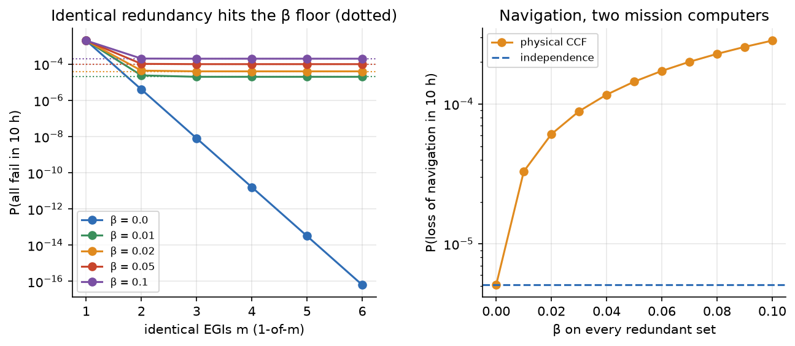

# Lesson 2 · When one cause breaks two channels

> Lesson 1 promised that a second navigation unit makes losing both 500 times less likely.
> Reliability engineers stopped believing promises of that kind decades ago, after studying
> real redundant systems in nuclear plants and finding that "independent" trains failed
> together far more often than the product rule allowed. This lesson builds the classical
> correction, the common-cause failure (CCF) models of the nuclear probabilistic-risk-assessment
> literature, and measures how much of the promise survives on the navigation system.

**Code:** [`src/cyberccf/physical_ccf_beta_factor/`](../../src/cyberccf/physical_ccf_beta_factor/) ·
**Data:** [`ccf_parameters.csv`](../../src/cyberccf/data/ccf_parameters.csv) ·
**Tests:** [`tests/test_physical_ccf.py`](../../tests/test_physical_ccf.py) ·
**Results:** [`validation/results/physical_ccf.md`](../../validation/results/physical_ccf.md) ·
**Previous:** [Lesson 1](01-the-independence-assumption.md)

## Learning objectives

By the end of this lesson you should be able to:

1. Define a common-cause failure through its root cause and coupling factor, and give
   physical examples.
2. Write the basic parameter model of a common-cause group and the identity that ties its
   parameters to the total failure probability.
3. Derive the beta-factor, multiple Greek letter (MGL) and alpha-factor models from it, for
   staggered and non-staggered testing.
4. Prove that identical redundancy has a floor it cannot go below, and compute it.
5. State exactly when common cause makes a system less reliable, and give the counterexample
   where it does not.

---

## 1. What a common cause is

A **common-cause failure** is the failure of two or more components, within a short time
window, from a single shared cause. NUREG/CR-5485 (Mosleh, Rasmuson & Marshall, 1998)
analyses one as two ingredients:

* a **root cause**, the reason a component fails at all (a design error, a manufacturing
  defect, a maintenance error, an environmental stress, an external event), and
* a **coupling factor**, the property that makes several components susceptible to the
  same root cause at the same time (same design, same manufacturer, same location, same
  maintenance crew and procedure, same supply).

Two navigation units of the same model, installed in the same bay, maintained by the same
crew with the same procedure and fed by one generation system, share several coupling
factors. A software defect in their common code, a capacitor batch, a cooling failure or a
power transient can then remove both. The product rule $P(A_1 \cap A_2) = P(A_1)P(A_2)$ has
no term for any of this.

Hold on to the word **coupling factor**. Lesson 3's argument is that "same firmware", "same
network segment" and "same supplier" are coupling factors too, for a root cause that happens
to be an attacker.

## 2. The basic parameter model

Take a **common-cause component group** (CCCG) of $m$ identical components. In the
basic-event formulation of Lesson 1, each subset of the group can be failed by its own basic
event. By symmetry the probability depends only on the size $k$ of the subset:

```math
Q^{(m)}_k = P(\text{a basic event fails exactly } k \text{ specific components}), \qquad 1 \le k \le m.
```

$Q_1$ is the independent failure of one component; $Q_m$ fails the whole group. A given
component belongs to $\binom{m-1}{k-1}$ subsets of size $k$, so its total failure probability
is

```math
Q_t = \sum_{k=1}^{m} \binom{m-1}{k-1} Q^{(m)}_k .
```

For a 2-of-3 system (it fails when two or more of three components fail), the rare-event
approximation gives NUREG/CR-5485's Eq. 5.5:

```math
Q_s \approx 3 Q_1^2 + 3 Q_2 + Q_3 .
```

The independent term is **quadratic** and the common-cause terms are **linear**. That
asymmetry is the whole story: whenever $Q_2$ is not tiny compared with $Q_1^2$, common cause
dominates.

The basic parameter model has $m$ parameters per group and they are hard to estimate directly,
so the literature re-parameterises it as fractions of $Q_t$. This project writes every model
as $f_k = Q_k / Q_t$, with $\sum_k \binom{m-1}{k-1} f_k = 1$
([`parametric.py`](../../src/cyberccf/physical_ccf_beta_factor/parametric.py)).

## 3. The beta factor

The **beta-factor model** (Fleming, 1975) is the simplest: a fraction $\beta$ of each
component's failures are common cause and fail the whole group, the rest are independent.

```math
f_1 = 1 - \beta, \qquad f_m = \beta, \qquad f_k = 0 \text{ otherwise}.
```

In rate terms a component with total rate $\lambda$ has an independent part at
$(1-\beta)\lambda$ and the group has one common-cause event at $\beta\lambda$. A 1-of-$m$ group
fails if the common-cause event occurs or every independent part fails:

```math
Q_{1\text{-of-}m} = q_c + (1 - q_c)\, q_i^{m}, \qquad q_i = 1 - e^{-(1-\beta)\lambda t}, \quad q_c = 1 - e^{-\beta\lambda t}.
```

As $m \to \infty$ the second term vanishes and

```math
\lim_{m \to \infty} Q_{1\text{-of-}m} = q_c = 1 - e^{-\beta\lambda t} \approx \beta\lambda t .
```

**This is the floor.** No number of identical units goes below it, because every one of them
is exposed to the same common cause. For two units the approximation
$Q \approx \beta q + (1-\beta)^2 q^2$ shows the two terms; the common-cause term wins as soon
as $\beta > q$ (roughly), and for an EGI over ten hours $q \approx 0.002$.



The left panel is the result. With $\beta = 0.02$:

| | independence | β = 0.02 |
|---|---|---|
| 1 EGI | $2.0 \times 10^{-3}$ | $2.0 \times 10^{-3}$ |
| 2 EGIs | $4.0 \times 10^{-6}$ | $4.4 \times 10^{-5}$ |
| 3 EGIs | $8.0 \times 10^{-9}$ | $4.0 \times 10^{-5}$ |
| gain of the 2nd unit | 500 | 46 |
| gain of the 3rd unit | 500 | 1.1 |

The second unit still helps a great deal; the third buys almost nothing.

### Where beta comes from

For safety-related electronics the IEC 61508-6 Annex D scoring method gives beta values
between 0.005 and 0.05 for programmable electronic equipment and between 0.01 and 0.1 for
field equipment, depending on the defences in place (as quoted by Gandy, 2023; the standard is
paid and is cited here only through that secondary source). The values used here, 0.02 for
the EGIs and computers and 0.05 for the bus channels and power buses
([`ccf_parameters.csv`](../../src/cyberccf/data/ccf_parameters.csv)), are **assumptions**
inside those ranges, and the right panel of the figure sweeps beta from 0 to 0.1.

## 4. More parameters: MGL and alpha factor

The beta factor says nothing about groups of three or more except "all or one". Two
multi-parameter models fill the gap.

### Multiple Greek letter

The MGL model (NUREG/CR-5485, section 5.4) uses conditional probabilities: $\beta$ is the
probability that a component failure's cause is shared with at least one more component,
$\gamma$ the probability that a cause shared with one is shared with at least two, $\delta$
the next, and so on. With $\rho_1 = 1$, $\rho_2 = \beta$, $\rho_3 = \gamma$, ... and
$\rho_{m+1} = 0$,

```math
f_k = \frac{1}{\binom{m-1}{k-1}} \left(\prod_{i=1}^{k} \rho_i\right)(1 - \rho_{k+1}).
```

For $m = 3$ this is NUREG/CR-5485's Eq. 5.11: $f_1 = 1-\beta$, $f_2 = \beta(1-\gamma)/2$,
$f_3 = \beta\gamma$. The beta factor is MGL with every further letter equal to 1.

### Alpha factor

The **alpha-factor** model is the one NUREG/CR-5485 recommends, because its parameters can be
estimated from event counts: $\alpha_k$ is the fraction of failure *events* in the group that
involve exactly $k$ components. How events convert into per-component probabilities depends
on how the components were tested when the data were collected:

```math
\text{staggered: } f_k = \frac{\alpha_k}{\binom{m-1}{k-1}}, \qquad \text{non-staggered: } f_k = \frac{k}{\binom{m-1}{k-1}} \frac{\alpha_k}{\alpha_t}, \quad \alpha_t = \sum_{k} k\,\alpha_k .
```

The non-staggered form follows from the definition. If $\alpha_k$ is the share of events of
size $k$, then $\binom{m}{k} Q_k = \alpha_k S$, with $S$ the total event probability. Since
$\binom{m}{k} = \frac{m}{k}\binom{m-1}{k-1}$, we get $\binom{m-1}{k-1} Q_k = k\alpha_k S/m$.
Summing over $k$ gives $Q_t = \alpha_t S/m$; eliminating $S$ gives the formula.

The tests check every row of NUREG/CR-5485's Tables 5-4 (staggered) and 5-5 (non-staggered)
that applies, against the exact engine with the independent part switched off.

### What the extra letter changes

For three EGIs with the same $\beta = 0.02$ ([results](../../validation/results/physical_ccf.md)):

| 3 EGIs | independent | γ = 1 (beta factor) | γ = 0.5 | γ = 0.1 |
|---|---|---|---|---|
| 1-of-3 | $8.0 \times 10^{-9}$ | $4.0 \times 10^{-5}$ | $2.0 \times 10^{-5}$ | $4.1 \times 10^{-6}$ |
| 2-of-3 | $1.2 \times 10^{-5}$ | $5.1 \times 10^{-5}$ | $6.1 \times 10^{-5}$ | $6.9 \times 10^{-5}$ |

Lowering $\gamma$ turns triple failures into pairs. A 1-of-3 system survives a pair, so it
improves; a 2-of-3 voter does not, so it gets worse. The beta factor is conservative for the
first and optimistic for the second: the model choice depends on the success criterion.

## 5. Does common cause always hurt?

The plan asks for a check: "CCF-adjusted reliability must always be less than or equal to the
naive independence estimate." It is true for **redundant** groups, and the reason is worth
stating.

**Claim.** If a common-cause group is the set of children of one parallel (1-of-$m$) block,
and its members appear nowhere else, then adding any parametric CCF model never lowers the
system's failure probability.

*Proof.* Each member's total failure probability is unchanged (its events are independent
Poisson processes whose rates add to $\lambda$; tested). The members' failure indicators are
increasing functions of independent basic events, so they are **associated** (Esary, Proschan
& Walkup, 1967), and for associated events $P(\cap_i A_i) \ge \prod_i P(A_i)$. So the block
fails at least as often as under independence. The block is independent of the rest of the
system, and a coherent system's failure probability does not decrease when one independent
block's failure probability increases. $\square$

For the beta factor the inequality is just Jensen's: with $a = 1 - q_c$,
$1 - a + a q_i^m \ge (1 - a + a q_i)^m$ because $x \mapsto x^m$ is convex.

**The counterexample.** In a **series** group, failures that coincide "waste" each other. Two
components in series with $\lambda t = 0.1$ each fail the system with probability $0.181$
independently, and with $0.139$ if half of their failures are common cause. The Hypothesis
test checks the claim on random systems; a second test records the series case. All of the
groups in this project are redundant sets, so the plan's check applies to every result here.

## 6. The navigation system

Every redundant set becomes a beta-factor group: the EGIs, the bus channels, the power buses
and, in the dual variant, the mission computers.

| variant | independence | physical CCF | ratio |
|---|---|---|---|
| 1 mission computer | $5.05 \times 10^{-4}$ | $5.60 \times 10^{-4}$ | 1.11 |
| 2 mission computers | $5.09 \times 10^{-6}$ | $6.99 \times 10^{-5}$ | 13.7 |

With one computer, the single point of failure hides the effect. With two, the system that
looked 99 times better than the single-computer design is only **8 times** better: of the two
orders of magnitude the second computer was supposed to buy, 0.9 are left. Its leading cut sets
are now **of order one**: the EGI common-cause event (57 % of the total), the computers'
(14 %) and the bus channels' (7 %). The independent pair of EGIs, which dominated under
independence, is down to 5 %.

Because each common-cause event fails a whole redundant set, it factors out of the
structure exactly, and the tests check the engine against

```math
R = R_{\text{ind}}(q_i) \cdot (1 - q_{c,\text{egi}})(1 - q_{c,\text{bus}})(1 - q_{c,\text{power}}).
```

### Defences

NUREG/CR-5485 lists the classical defences against coupling: **diversity** (functional,
staff, equipment), physical **barriers** and separation, and **staggered** testing and
maintenance. Each attacks a coupling factor rather than a root cause. Diversity is the one
that reappears, with a new meaning, in Lesson 4.

## 7. Worked example

```python
from cyberccf.independence_baseline import MISSION_HOURS, navigation_model, unreliability
from cyberccf.physical_ccf_beta_factor import (
    mgl_fractions,
    one_of_m_beta_unreliability,
    physical_ccf_model,
)

print(one_of_m_beta_unreliability(2, 2e-4, 0.02, MISSION_HOURS))  # 4.383e-05
print(mgl_fractions(3, [0.1, 0.3]))  # [0.9, 0.035, 0.03]
dual = physical_ccf_model(mission_computers=2)
print(unreliability(dual, MISSION_HOURS))  # 6.986e-05
print(unreliability(navigation_model(mission_computers=2), MISSION_HOURS))  # 5.089e-06
```

By hand: $q = 1 - e^{-0.002} = 0.001998$; $\beta q = 3.996 \times 10^{-5}$;
$((1-\beta)q)^2 = 3.834 \times 10^{-6}$; the sum, $4.379 \times 10^{-5}$, is within 0.1 % of
the exact value.

## 8. Code walkthrough

* [`parametric.py`](../../src/cyberccf/physical_ccf_beta_factor/parametric.py): the fractions
  of every model, the conservation check and the alpha conversions.
* [`groups.py`](../../src/cyberccf/physical_ccf_beta_factor/groups.py): `CCFGroup` and
  `apply_ccf`, which splits the members' own events and adds one shared event per subset.
* [`navigation.py`](../../src/cyberccf/physical_ccf_beta_factor/navigation.py): one beta
  group per redundant set of the navigation system.
* [`closed_form.py`](../../src/cyberccf/physical_ccf_beta_factor/closed_form.py): the 1-of-m
  formula (written as $q_c + (1-q_c)q_i^m$ because the $1 - (1-q_c)(1-q_i^m)$ form loses
  precision to cancellation, which a test caught) and the floor.

## Exercises

1. Show that for a 1-of-2 beta group with small $q$, the common-cause term exceeds the
   independent term when $\beta > (1-\beta)^2 q$. What is the threshold for an EGI over 10 h?
2. With non-staggered testing and $m = 2$, show that the beta factor equivalent to
   $\alpha = (0.95, 0.05)$ is $2\alpha_2/(\alpha_1 + 2\alpha_2)$, and evaluate it. Why is it
   larger than $\alpha_2$?
3. Verify that the MGL fractions for $m = 4$ satisfy the conservation identity for any
   $\beta, \gamma, \delta$.
4. Compute the series counterexample of section 5 and explain it in words.
5. A designer proposes a third identical mission computer. Using the beta factor with
   $\beta = 0.02$ and the floor formula, what is the most this can achieve against the
   computers' common-cause event?

### Solutions

1. Compare $\beta q$ with $(1-\beta)^2 q^2$: the first is larger when $\beta > (1-\beta)^2 q$,
   that is $\beta \gtrsim q \approx 0.002$. Every beta in the literature range is above it.
2. $Q_2 = 2\alpha_2 Q_t/(\alpha_1 + 2\alpha_2)$ and $\beta = Q_2/Q_t$, so
   $\beta = 0.1/1.05 = 0.095$. In non-staggered testing one event of size 2 means *two* failed
   components, so per component it carries twice the weight it has as an event count.
3. $f_1 + 3f_2 + 3f_3 + f_4 = (1-\beta) + \beta(1-\gamma) + \beta\gamma(1-\delta) + \beta\gamma\delta = 1$.
4. Independent: $1 - e^{-0.2} = 0.181$. With $\beta = 0.5$ the system fails when any of three
   events occurs, at total rate $0.005 + 0.005 + 0.005$ per hour, so $1 - e^{-0.15} = 0.139$.
   Common cause concentrates the failures into fewer moments; a series system cares only
   whether at least one happened.
5. The computers' common-cause event occurs with $1 - e^{-0.02 \times 5 \times 10^{-5} \times 10} = 1.0 \times 10^{-5}$
   per mission whatever their number. The third computer can only remove the independent
   pair term ($2.4 \times 10^{-7}$), about 2 % of the computers' contribution.

## References

* K. N. Fleming, *A Reliability Model for Common Mode Failures in Redundant Safety Systems*,
  General Atomic report GA-A13284, 1975 (the beta-factor model).
* A. Mosleh, D. M. Rasmuson and F. M. Marshall, *Guidelines on Modeling Common-Cause Failures
  in Probabilistic Risk Assessment*, NUREG/CR-5485, U.S. Nuclear Regulatory Commission, 1998
  (Eqs. 5.5-5.11, Tables 5-4 and 5-5; root causes, coupling factors and defences).
* J. E. Stott, P. T. Britton, R. W. Ring, F. Hark and G. S. Hatfield, "Common Cause Failure
  Modeling: Aerospace vs. Nuclear," NASA Technical Reports Server 20100025991, 2010
  (the basic parameter model and the testing-scheme issue).
* S. Gandy, "The importance of considering common cause with redundant systems," exida blog,
  15 August 2023 (the IEC 61508-6 Annex D beta ranges).
* J. D. Esary, F. Proschan and D. W. Walkup, "Association of random variables, with
  applications," *Annals of Mathematical Statistics* 38(5), 1967.
* M. Rausand and A. Høyland, *System Reliability Theory*, 2nd ed., Wiley, 2004
  (dependent failures).
