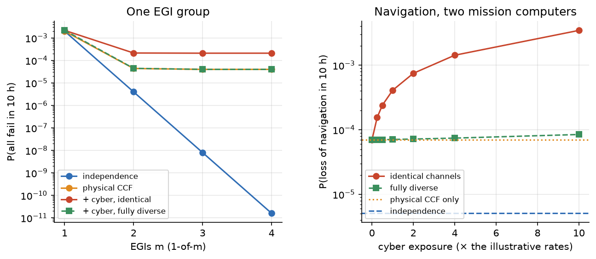

# Lesson 3 · The cyber beta factor

> Two mission computers loaded with the same software image from the same loader, on the same
> network segment, bought from the same supplier, are redundant against a failed power supply.
> Against a vulnerability in that image, they are one computer. This lesson extends the
> common-cause model of Lesson 2 to that case: it treats "same firmware", "same segment" and
> "same supplier" as coupling factors, defines a cyber beta factor, and measures what it does
> to the redundancy the navigation system was designed with.

**Code:** [`src/cyberccf/cyber_ccf_model/`](../../src/cyberccf/cyber_ccf_model/) ·
**Data:** [`cyber_exposures.csv`](../../src/cyberccf/data/cyber_exposures.csv),
[`navigation_attributes.csv`](../../src/cyberccf/data/navigation_attributes.csv) ·
**Tests:** [`tests/test_cyber_ccf.py`](../../tests/test_cyber_ccf.py) ·
**Results:** [`validation/results/cyber_ccf.md`](../../validation/results/cyber_ccf.md) ·
**Derivation:** [`docs/derivation.md`](../derivation.md) ·
**Previous:** [Lesson 2](02-when-one-cause-breaks-two-channels.md)

## Learning objectives

By the end of this lesson you should be able to:

1. Explain why a shared cyber vulnerability is a common-cause failure in the precise sense of
   Lesson 2, and name its coupling factors.
2. Model a shared vulnerability by its effect, as a basic event defined by an attribute value,
   and give its rate as a thinned Poisson process.
3. Define the cyber beta factor of a channel and derive how it combines with the physical one.
4. Compute what identical and diverse channels give, and prove that diversifying never makes a
   redundant group less reliable.
5. Say what the model does *not* capture, and which conclusions depend on its assumptions.

---

## 1. Same root-cause anatomy, new coupling factors

Lesson 2 described a common-cause failure as a **root cause** plus a **coupling factor**. Put
an attacker in the root-cause slot and the anatomy is unchanged:

| coupling factor | physical example | cyber example |
|---|---|---|
| same design | a design error in both units | a vulnerability in the image both units run |
| same location or connection | a cooling duct, a cable route | a network segment both units sit on |
| same source | a defective component batch | a compromised part or loading tool from one supplier |

There is one important difference. A physical root cause acts at random; it does not *look*
for the coupling factor. An attacker does. A vulnerability in the image that both computers
run is not a coincidence the attacker benefits from; it is the reason the attacker chose that
image. So a shared vulnerability is not a rare form of common cause; it is the *expected*
form, and identical redundancy is the configuration that maximises it.

## 2. A shared vulnerability as a basic event

The model stays at the level of **effect**, as [`scope.md`](../scope.md) requires. Each
programmable channel (the EGIs and the mission computers) carries three attributes: its
firmware or software image, its network segment and its supply-chain source. For each
attribute $d$ and each value $v$ held by some channel there is one basic event:

> "a shared vulnerability in $d = v$ is exploited", which fails every channel with $d = v$.

Nothing else about the vulnerability is modelled: which one, how it is found or exploited.
The reliability model only needs to know *which channels fall together and how often*.

The rate is a thinned Poisson process. Attempts against value $v$ of attribute $d$ arrive at
rate $\nu_d$, and each one defeats the channels with probability $p_d$, so

```math
\lambda_d = \nu_d\, p_d .
```

| attribute | attempts per hour | P(defeats) | effective rate |
|---|---|---|---|
| firmware | $2 \times 10^{-5}$ | 0.5 | $1.0 \times 10^{-5}$ |
| network | $2 \times 10^{-5}$ | 0.25 | $5.0 \times 10^{-6}$ |
| supply chain | $2 \times 10^{-6}$ | 1.0 | $2.0 \times 10^{-6}$ |

**These numbers have no field-data basis.** They are illustrative assumptions
([`cyber_exposures.csv`](../../src/cyberccf/data/cyber_exposures.csv)), and every conclusion
below is also shown across a 0 to 10 times range of them. A channel's total cyber exposure is
$\lambda_c = \sum_d \lambda_d = 1.7 \times 10^{-5}$ per hour.

### Exposure is conserved, sharing is not

The rate is defined **per attribute value**, so a channel's own exposure $\lambda_c$ does not
depend on what the other channels run. What the architecture decides is *who shares it*.
Identical channels share every cyber event: each is a common-cause event (kind `cyber_ccf`).
Fully diverse channels share none: each event fails one channel, exactly like an extra
independent failure (kind `cyber_independent`). This is the same move Lesson 2 made for
physical common cause, where each component's total rate stayed fixed and only the coupling
changed, and it is what makes identical and diverse architectures comparable.

## 3. The cyber beta factor

**Definition.** The cyber beta factor of a channel is the share of its total failure rate
that comes from cyber events shared with at least one other channel:

```math
\beta_c = \frac{\sum_{e \,\text{shared, cyber}} \lambda_e}{\sum_{e \,\text{fails the channel}} \lambda_e}.
```

For identical channels with physical rate $\lambda_p$ and exposure $\lambda_c$,
$\beta_c = \lambda_c/(\lambda_p + \lambda_c)$. For an EGI at the illustrative exposure,
$\beta_c = 1.7 \times 10^{-5} / 2.17 \times 10^{-4} = 0.078$: a cyber beta factor the same size
as the physical beta factors of Lesson 2. For a mission computer, whose physical rate is four
times lower, it is 0.25.

**How it combines with the physical beta.** A failure of an identical channel is independent
only if it is physical (share $1 - \beta_c$) *and* not a physical common cause (share
$1 - \beta_p$ of the physical part). So the effective beta factor is

```math
1 - \beta = (1 - \beta_p)(1 - \beta_c), \qquad \beta = \beta_p + \beta_c - \beta_p \beta_c .
```

For an EGI: $1 - (0.98)(0.922) = 0.097$. The tests check this identity against the share
computed from the model's events, for random $\beta_p$ and $\beta_c$. The consequence is the
one that matters: **every classical beta-factor formula applies unchanged with $\beta$ in
place of $\beta_p$**, so the floor of Lesson 2 becomes

```math
\lim_{m \to \infty} Q_{1\text{-of-}m} = 1 - e^{-(\beta_p \lambda_p + \lambda_c) t}.
```

A reliability engineer can plug the correction into an existing beta-factor calculation. The
full derivation, with proofs, is in [`docs/derivation.md`](../derivation.md).

## 4. Identical and diverse groups

For a 1-of-$m$ group, with $q_{cc}$ the common event and $q_i$ each channel's own failure:

```math
\text{identical: } q_{cc} = 1 - e^{-(\beta_p\lambda_p + \lambda_c)t}, \quad q_i = 1 - e^{-(1-\beta_p)\lambda_p t};
```

```math
\text{diverse: } q_{cc} = 1 - e^{-\beta_p\lambda_p t}, \quad q_i = 1 - e^{-((1-\beta_p)\lambda_p + \lambda_c)t};
```

and in both cases $Q = q_{cc} + (1 - q_{cc}) q_i^{m}$. Diversity moves $\lambda_c$ out of the
linear term and into the squared one.



| EGIs (1-of-m) | independence | physical CCF | + cyber, identical | + cyber, fully diverse |
|---|---|---|---|---|
| 1 | $2.0 \times 10^{-3}$ | $2.0 \times 10^{-3}$ | $2.2 \times 10^{-3}$ | $2.2 \times 10^{-3}$ |
| 2 | $4.0 \times 10^{-6}$ | $4.4 \times 10^{-5}$ | $2.1 \times 10^{-4}$ | $4.5 \times 10^{-5}$ |
| 3 | $8.0 \times 10^{-9}$ | $4.0 \times 10^{-5}$ | $2.1 \times 10^{-4}$ | $4.0 \times 10^{-5}$ |

A pair of identical EGIs is now only 10 times better than one EGI, not 500 times. A diverse
pair is almost back at the physical-CCF figure: the residual is the physical floor, which
diversity in *software* does not touch.

### Diversifying never hurts a redundant group

**Proposition.** Take a parallel group whose members appear nowhere else in the system. Split
one shared event of probability $k$, acting on members $A \cup B$, into two independent events
of the same probability, one acting on $A$ and one on $B$. Let $U$ ($V$) be the event that
every member of $A$ ($B$) fails from its other causes. Then $P(\text{group fails})$ drops by
exactly

```math
\Delta = k(1-k)\, P(\bar U \cap \bar V) \ge 0 .
```

*Proof.* With the shared event, the group fails if it occurs or if $U \cap V$:
$k + (1-k)P(U \cap V)$. With two events, it fails if ($K_A$ or $U$) and ($K_B$ or $V$):
$k^2 + k(1-k)\left[P(U) + P(V)\right] + (1-k)^2 P(U \cap V)$. Subtracting gives
$k(1-k)\left[1 - P(U) - P(V) + P(U \cap V)\right]$, and the bracket is $P(\bar U \cap \bar V)$.
$\square$

Any refinement of an attribute (more distinct values) is a sequence of such splits, so
diversifying an attribute never makes a redundant group less reliable. The tests check the
identity exactly, and the property on random attribute patterns with Hypothesis.

## 5. The navigation system

The baseline gives the two EGIs one image, one segment and one source, and the same for the
two mission computers ([attributes](../../src/cyberccf/data/navigation_attributes.csv)):

| two mission computers | P(loss of navigation, 10 h) | vs independence |
|---|---|---|
| independence, as usually claimed | $5.1 \times 10^{-6}$ | 1 |
| physical CCF | $7.0 \times 10^{-5}$ | 14 |
| physical + cyber CCF, identical channels | $4.1 \times 10^{-4}$ | 81 |
| ... with fully diverse EGIs and computers | $7.1 \times 10^{-5}$ | 14 |

And the design decision Lesson 1 started from, the second mission computer:

| model | one computer | two computers | benefit of the 2nd |
|---|---|---|---|
| independence | $5.0 \times 10^{-4}$ | $5.1 \times 10^{-6}$ | 99 × |
| physical CCF | $5.6 \times 10^{-4}$ | $7.0 \times 10^{-5}$ | 8.0 × |
| physical + cyber, identical | $9.0 \times 10^{-4}$ | $4.1 \times 10^{-4}$ | 2.2 × |

Of the two orders of magnitude the second computer was claimed to buy, physical common cause
leaves 0.9 and shared cyber vulnerabilities leave **0.34**. The leading cut sets are now
single cyber events: the EGI image and the computer image (24 % each), the two segments
(12 % each), then the physical EGI common cause (10 %). Order-one cut sets of cyber origin
carry 83 % of the total.

Because every cyber event of an identical architecture fails a whole redundant set (or a
series element), it factors out exactly, and the tests check

```math
R = R_{\text{physical}} \prod_{e \,\in\, \text{cyber}} (1 - q_e).
```

### A trap: the shared network segment

Putting the EGIs and the computers on **one** segment looks worse and comes out *better*
($3.6 \times 10^{-4}$ against $4.1 \times 10^{-4}$). There are two reasons, and both are
lessons:

1. The EGI group and the computer group are in **series**. A single event that defeats both
   is no worse than one that defeats either, because either is already fatal. This is the
   series caveat of Lesson 2: coupling series elements does not hurt.
2. The model's rate is **per attribute value**. Merging two segments into one turns two
   targets into one and halves that exposure.

The second reason is an assumption, not a fact. A segment with twice as many nodes plausibly
offers twice the entry points. Doubling its exposure for the doubled attack surface gives
$4.1 \times 10^{-4}$, the same as two segments. The honest conclusion is narrower: **cross-group
coupling does not matter here; how the attack rate scales with the attack surface does**, and
the data to settle that do not exist.

### Sensitivity

The right panel of the figure scales every cyber rate from 0 to 10 times. Identical channels
degrade almost linearly with the exposure, reaching $3.5 \times 10^{-3}$ at ten times
($\beta_c = 0.46$ for an EGI). Fully diverse channels barely move, from $7.0 \times 10^{-5}$ to
$8.5 \times 10^{-5}$: their cyber failures meet in the squared term only. At the illustrative
exposure identical channels are 5.8 times worse than diverse ones; at ten times, 41 times
worse. The gap, not its exact size, is the robust result.

## 6. What the model leaves out

* **Dependence on the attacker.** Events are independent Poisson processes. A real attacker
  who compromises the image may also choose *when* to act, for instance during a critical
  mission phase. Mission-phase timing is out of scope.
* **Partial effects.** An event defeats every holder, fully. Attacks that degrade one channel,
  or corrupt data without stopping it (the subject of CPS-03), are other failure modes.
* **Field data.** Physical beta factors rest on decades of event data; cyber rates rest on
  none. That is why every result is shown across a range, and why Lesson 7 maps security
  posture to a *range* of $\beta_c$, never a point.

## 7. Worked example

```python
from cyberccf.cyber_ccf_model import (
    combined_beta,
    cyber_beta,
    cyber_ccf_model,
    identical_group_unreliability,
)
from cyberccf.independence_baseline import MISSION_HOURS, unreliability

model = cyber_ccf_model(mission_computers=2)
print(cyber_beta(model, "egi_1"))  # 0.0783
print(combined_beta(0.02, 0.0783))  # 0.0967
print(unreliability(model, MISSION_HOURS))  # 4.098e-04
print(identical_group_unreliability(2, 2e-4, 0.02, 1.7e-5, MISSION_HOURS))  # 2.138e-04
```

By hand for the EGI pair: the common event has rate
$0.02 \times 2 \times 10^{-4} + 1.7 \times 10^{-5} = 2.1 \times 10^{-5}$, so
$q_{cc} \approx 2.1 \times 10^{-4}$; the independent pair adds
$(0.98 \times 0.002)^2 = 3.8 \times 10^{-6}$; total $2.14 \times 10^{-4}$.

## 8. Code walkthrough

* [`shared_vulnerability.py`](../../src/cyberccf/cyber_ccf_model/shared_vulnerability.py):
  `Exposure` (attempt rate, success probability, basis), `apply_cyber` (one event per
  attribute value, `cyber_ccf` when shared), `cyber_beta` and `common_cause_share`.
* [`closed_form.py`](../../src/cyberccf/cyber_ccf_model/closed_form.py): the conversions
  between rates and $\beta_c$, `combined_beta`, the identical and diverse group formulas and
  the split gain of the proposition.
* [`navigation.py`](../../src/cyberccf/cyber_ccf_model/navigation.py): attributes of the
  programmable channels, the `distinct` knob for diversity and the shared-segment option.

## Exercises

1. Show that $\beta = \beta_p + \beta_c - \beta_p\beta_c$ is at least $\max(\beta_p, \beta_c)$.
   What does that say about adding a cyber correction to a physical one?
2. A mission computer has $\lambda_p = 5 \times 10^{-5}$ per hour. What cyber exposure gives it
   $\beta_c = 0.1$? Compare it with the illustrative $1.7 \times 10^{-5}$.
3. For a 1-of-2 identical group, find the first-order condition on $\lambda_c t$ under which
   fully diverse channels are better, and show it holds for any realistic exposure.
4. Three EGIs run images A, A and B. Which cyber events exist, which channels does each fail,
   and is this group better or worse than A, A, A? Than A, B, C?
5. Why is "the second computer buys 2.2 times" a more useful sentence for a design review than
   "the system is 80 times less reliable than claimed"?

### Solutions

1. $\beta - \beta_p = \beta_c(1 - \beta_p) \ge 0$ and symmetrically. Corrections only add: no
   cyber term can make a physically coupled group look less coupled.
2. $\lambda_c = \lambda_p\beta_c/(1-\beta_c) = 5 \times 10^{-5} \times 0.1/0.9 = 5.6 \times 10^{-6}$
   per hour, a third of the illustrative exposure, which gives it $\beta_c = 0.25$.
3. With $x = (1-\beta_p)\lambda_p t$ and $c = \lambda_c t$, identical gives
   $\approx \beta_p\lambda_p t + c + x^2$ and diverse $\approx \beta_p\lambda_p t + (x + c)^2$.
   Diverse is better when $c > 2xc + c^2$, that is $2x + c < 1$: always, for probabilities
   per mission much below one half. The exact proposition of section 4 removes even that
   condition.
4. Events A (fails EGI 1 and 2) and B (fails EGI 3). The group fails if A occurs and EGI 3
   fails otherwise, or B and the pair fail otherwise, and so on. It is a refinement of A, A, A
   (better, by the proposition) and A, B, C is a refinement of it (better again).
5. The first compares the system with a number nobody should have believed; the second says
   what a specific design decision buys, which is what the review is deciding.

## References

* A. Mosleh, D. M. Rasmuson and F. M. Marshall, *Guidelines on Modeling Common-Cause Failures
  in Probabilistic Risk Assessment*, NUREG/CR-5485, U.S. NRC, 1998 (root causes, coupling
  factors, the basic-event formulation).
* K. N. Fleming, *A Reliability Model for Common Mode Failures in Redundant Safety Systems*,
  General Atomic report GA-A13284, 1975.
* T. Shorthill, H. Bao, E. Chen and H. Ban, "An Application of a Modified Beta Factor Method
  for the Analysis of Software Common Cause Failures," arXiv:2206.11321, 2022 (beta-factor
  methods for software CCF in digital instrumentation and control; see Lesson 8).
* A. Avižienis, "The N-version approach to fault-tolerant software," *IEEE Transactions on
  Software Engineering* SE-11(12), 1985 (design diversity as a defence against common faults).
