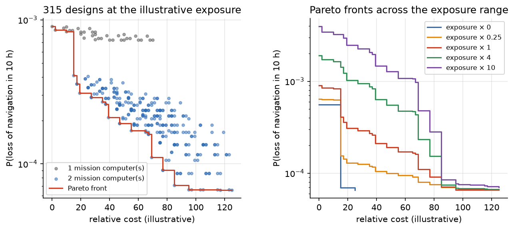

# Lesson 4 · Buying independence

> Lesson 3 showed that identical channels share their cyber exposure, and proved that
> diversifying never hurts a redundant group. Never hurting is not the same as being worth the
> money. Dissimilar firmware is expensive, a second network segment is cheap, and a third
> identical unit is somewhere in between. This lesson costs every design of the navigation
> system, finds the ones worth buying, and asks the question the research behind this project
> must answer: **which conclusions survive when we do not know the cyber exposure?**

**Code:** [`src/cyberccf/architecture_diversity_tradeoff/`](../../src/cyberccf/architecture_diversity_tradeoff/) ·
**Data:** [`diversity_costs.csv`](../../src/cyberccf/data/diversity_costs.csv) ·
**Tests:** [`tests/test_diversity_tradeoff.py`](../../tests/test_diversity_tradeoff.py) ·
**Results:** [`validation/results/diversity.md`](../../validation/results/diversity.md) ·
**Previous:** [Lesson 3](03-the-cyber-beta-factor.md)

## Learning objectives

By the end of this lesson you should be able to:

1. Describe a design space of redundant architectures by unit counts and per-attribute
   diversity, and enumerate it.
2. Compute a Pareto front of cost against unreliability, and pick the best design within a
   budget.
3. Rank single design changes by the reliability they buy per unit of cost.
4. Separate the conclusions that depend on the unknown cyber exposure from those that do not,
   and explain why.

---

## 1. The design space

An architecture fixes:

* how many EGIs (2 or 3) and mission computers (1 or 2) are fitted, and
* for each of the two programmable groups and each attribute (firmware, network, supplier),
  how many **distinct values** its members use: 1 means identical, the group size means fully
  diverse. Member $i$ gets value $i \bmod n$.

That gives $(2^3 + 3^3) \times (1 + 2^3) = 315$ designs. Each one is quantified exactly at
the illustrative exposure, and, because changing the exposure changes only event *rates*,
re-evaluated at any other exposure from the same binary decision diagram
(`unreliability_at_scale`, tested against rebuilding the model).

### Costs

| item | EGIs | mission computers |
|---|---|---|
| one more identical unit | 10 | 15 |
| one more dissimilar firmware or software image | 20 | 30 |
| one more network segment | 2 | 2 |
| one more qualified supplier | 8 | 8 |

These are **illustrative relative costs**, not data. Their only real content is the order,
cheap segmentation and expensive dissimilar software, which follows the N-version programming
literature (Avižienis, 1985): building and certifying a second independent implementation is
the dearest form of diversity. Section 4 shows which conclusions depend on these numbers.

## 2. The Pareto front

A design is **dominated** if another costs no more and fails no more often, and is strictly
better in one of the two. The non-dominated designs form the **Pareto front**: the only ones a
rational designer would consider, whatever their budget. Sorted by cost, the front's
unreliability strictly decreases (`pareto_front`, tested against brute force).



At the illustrative exposure the front ([results](../../validation/results/diversity.md)) is,
in its first steps:

| cost | P(loss, 10 h) | design |
|---|---|---|
| 0 | $9.0 \times 10^{-4}$ | 2 EGI + 1 MC |
| 15 | $4.1 \times 10^{-4}$ | 2 EGI + 2 MC |
| 19 | $3.1 \times 10^{-4}$ | ... and both groups' segments split |
| 39 | $2.1 \times 10^{-4}$ | ... and a second EGI firmware image |
| 69 | $1.1 \times 10^{-4}$ | ... and a second computer software load |
| 85 | $7.1 \times 10^{-5}$ | fully diverse EGI and computer pairs |
| 95 | $6.6 \times 10^{-5}$ | ... and a third EGI |

Three features are worth naming.

* **The second mission computer is still the first buy.** The single computer is a series
  element; nothing else matters while it is there.
* **The third EGI appears only at the very end**, after every form of diversity has been
  bought, and buys 6 %.
* **Diversity is bought in order of price per effect**: segments, then suppliers, then
  firmware.

## 3. What each change buys

Starting from two identical EGIs and two identical computers, the reduction in
P(loss of navigation) per cost unit of each single change ranks as follows:

| exposure | best value | second | third |
|---|---|---|---|
| × 0 | third identical EGI | 2nd EGI firmware | 2nd EGI segment |
| × 0.25 | 2nd computer segment | 2nd EGI segment | 2nd EGI firmware |
| × 1 | 2nd computer segment | 2nd EGI segment | 2nd EGI firmware |
| × 10 | 2nd computer segment | 2nd EGI segment | 2nd EGI firmware |

With no cyber exposure, diversity buys nothing (Proposition 1 of the
[derivation](../derivation.md)) and the third identical unit is the only change that does
anything, although it buys little: $4.2 \times 10^{-6}$. With **any** exposure, the third
identical EGI drops to last place. It does not touch the common events, which now dominate.

## 4. What survives not knowing the exposure

The exposure has no field-data basis, so a conclusion is only worth stating if it holds across
the range. The results separate three kinds.

**Robust, structural.** These hold for every exposure, because they are theorems:

* Diversity never makes a redundant group worse (Proposition 5).
* A third identical unit cannot go below the floor $1 - e^{-\beta\Lambda t}$, which the cyber
  term raises (Proposition 7).
* Fully diverse pairs stay close to the physical-CCF figure at every exposure:
  $7.0 \times 10^{-5}$ at zero, $8.5 \times 10^{-5}$ at ten times (21 % more), while identical
  pairs go from $7.0 \times 10^{-5}$ to $3.5 \times 10^{-3}$ (50 times more). **Diversity turns
  a parameter nobody can estimate into one that barely matters.** This is the most useful
  result of the project for a designer.

**Robust, empirical.** The *ranking of diversity items among themselves* does not move with
the exposure level. Every cyber benefit is, to first order, proportional to the exposure
(splitting a shared event of rate $\lambda_d$ removes about $\lambda_d t$ from the common
term), so scaling all exposures scales all benefits equally and leaves the order unchanged.
The order depends only on the **relative** exposures of the attributes and on the **relative**
costs.

**Fragile.** What *does* move with the exposure level is the choice between diversity and
more hardware. Two examples from the budget table:

| exposure | budget 15 | best design |
|---|---|---|
| × 0 | 15 | 2 EGI + 2 MC (the second computer) |
| × 1 | 15 | 2 EGI + 2 MC (the second computer) |
| × 10 | 15 | 2 EGI [segments, suppliers split] + 1 MC (no second computer) |

At ten times the illustrative exposure, a second *identical* computer is worth less than
diversifying the EGIs for the same money, because two identical computers share three cyber
events. And at zero exposure, money beyond a budget of 25 buys nothing at all. A design review
that has to choose between a second identical unit and diversity is therefore exactly where
the cyber beta factor matters most, and where its range, not a point value, has to be shown.

## 5. Worked example

```python
from cyberccf.architecture_diversity_tradeoff import (
    cost,
    make_architecture,
    unreliability_at_scale,
)
from cyberccf.independence_baseline import MISSION_HOURS

base = make_architecture(2, 2)
split = make_architecture(2, 2, {("nav_source", "network"): 2, ("mission_computer", "network"): 2})
print(cost(split) - cost(base))  # 4.0
for s in (0.0, 1.0, 10.0):
    print(
        s,
        unreliability_at_scale(base.model(), MISSION_HOURS, s),
        unreliability_at_scale(split.model(), MISSION_HOURS, s),
    )
# 0.0  6.986e-05  6.986e-05
# 1.0  4.098e-04  3.101e-04
# 10.0 3.464e-03  2.470e-03
```

By hand at × 1: splitting the EGI segment turns one shared event of rate $5 \times 10^{-6}$
(probability $5 \times 10^{-5}$ per mission) into two private ones, whose contribution is now
second order; the same for the computers. The total drops by about $2 \times 5 \times 10^{-5}$,
from $4.10 \times 10^{-4}$ to $3.10 \times 10^{-4}$.

## 6. Code walkthrough

* [`architectures.py`](../../src/cyberccf/architecture_diversity_tradeoff/architectures.py):
  `Architecture` (unit counts and `distinct` levels, with a readable `label`),
  `enumerate_architectures`, `cost` from the cost table, and `unreliability_at_scale`, which
  rescales the cyber rates without rebuilding the BDD.
* [`pareto.py`](../../src/cyberccf/architecture_diversity_tradeoff/pareto.py): the front and
  the best design within a budget.
* The tests check the front against brute force, that refining any attribute never increases
  unreliability over the whole design space, and that at zero exposure every diversity level
  equals the physical model.

## Exercises

1. Show that a design on the Pareto front at one exposure can be dominated at another. Find an
   example in the results.
2. Explain, to first order, why splitting the EGI segment buys about $\lambda_{\text{net}} t$
   and why splitting the EGI firmware buys twice that at the illustrative rates.
3. Double the price of network segments for both groups. Does the ranking in section 3
   change? Which of the three kinds of conclusion in section 4 is this?
4. A reviewer says: "we don't know the cyber exposure, so we can't decide anything." Use
   section 4 to answer.

### Solutions

1. At × 0 the front ends at 3 EGI + 2 MC (cost 25), and every diversified design costs more
   for the same result, so all are dominated. At × 1 many of them are on the front. The front
   is a function of the exposure.
2. The segment event has rate $\lambda_{\text{net}} = 5 \times 10^{-6}$; splitting removes it
   from the order-one cut sets, worth $\approx \lambda_{\text{net}} t = 5 \times 10^{-5}$, and
   leaves second-order terms. Firmware has $\lambda_{\text{fw}} = 10^{-5}$: twice as much
   (results: $9.95 \times 10^{-5}$ against $4.98 \times 10^{-5}$).
3. Segments would cost 4 for an effect of $5 \times 10^{-5}$, still $1.2 \times 10^{-5}$ per
   unit, against $5.0 \times 10^{-6}$ per unit for EGI firmware: the ranking holds. It is a
   conclusion of the second kind: it depends on relative costs and relative exposures, and
   here the margin is large.
4. Some decisions do not depend on it: diversity is never worse, a third identical unit is a
   poor buy once exposure is non-zero, and diverse designs are insensitive to the exposure.
   One decision does depend on it: diversity against a second identical unit. For that one,
   show the range.

## References

* A. Avižienis, "The N-version approach to fault-tolerant software," *IEEE Transactions on
  Software Engineering* SE-11(12), 1985.
* A. Mosleh, D. M. Rasmuson and F. M. Marshall, NUREG/CR-5485, U.S. NRC, 1998 (diversity
  as a defence against coupling).
* V. Pareto, *Manuale di economia politica*, 1906 (the dominance criterion); see any text on
  multi-objective optimisation, for example K. Deb, *Multi-Objective Optimization using
  Evolutionary Algorithms*, Wiley, 2001.
