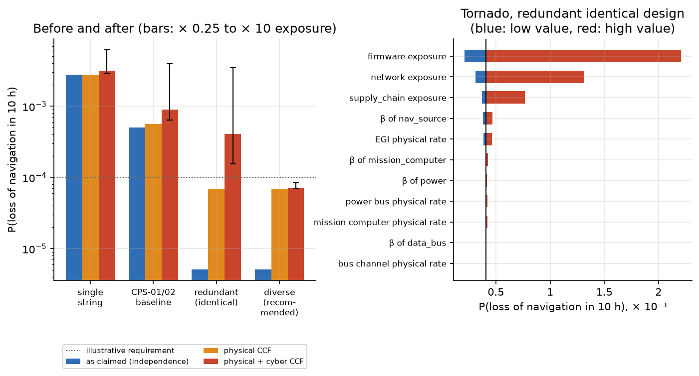

# Lesson 5 · Redundancy as claimed vs as it is

> Four lessons built the pieces: the independence baseline, physical common cause, the cyber
> beta factor and the cost of diversity. This lesson puts them together on one system, the
> navigation system of the CPS series, and produces the result the project exists for: a
> before-and-after picture of what redundancy actually buys, a ranking of what we are most
> unsure about, and a design recommendation that does not depend on the number we know least.

**Code:** [`src/cyberccf/case_study_application/`](../../src/cyberccf/case_study_application/) ·
**Tests:** [`tests/test_case_study.py`](../../tests/test_case_study.py) ·
**Results:** [`validation/results/case_study.md`](../../validation/results/case_study.md) ·
**Previous:** [Lesson 4](04-buying-independence.md)

## Learning objectives

By the end of this lesson you should be able to:

1. Present a redundancy claim in three views (independence, physical CCF, physical + cyber
   CCF) and say what each view assumes.
2. Measure "what redundancy buys" in orders of magnitude, and explain why that is the right
   unit for a design review.
3. Read a tornado diagram and use it to decide where more data would matter.
4. Turn a monotonicity result into a robust design rule, and state the rule's limits.

---

## 1. Four designs, three views



| design | as claimed | physical CCF | physical + cyber | range (× 0.25 to × 10) |
|---|---|---|---|---|
| single string: 1 EGI, 1 bus channel, 1 computer | $2.8 \times 10^{-3}$ | $2.8 \times 10^{-3}$ | $3.1 \times 10^{-3}$ | $2.9$ to $6.2 \times 10^{-3}$ |
| CPS-01/02 baseline: 2 EGI, 2 bus, 1 computer | $5.0 \times 10^{-4}$ | $5.6 \times 10^{-4}$ | $9.0 \times 10^{-4}$ | $6.4 \times 10^{-4}$ to $4.0 \times 10^{-3}$ |
| redundant, identical: 2 EGI, 2 bus, 2 computers | $5.1 \times 10^{-6}$ | $7.0 \times 10^{-5}$ | $4.1 \times 10^{-4}$ | $1.5 \times 10^{-4}$ to $3.5 \times 10^{-3}$ |
| diverse (recommended): both pairs diverse | $5.1 \times 10^{-6}$ | $7.0 \times 10^{-5}$ | $7.1 \times 10^{-5}$ | $7.0$ to $8.5 \times 10^{-5}$ |

P(loss of trusted navigation) per 10-hour mission. Read the table by rows and then by
columns.

* **By rows**, the single string barely moves between views: there is almost nothing to
  couple. The redundant identical design moves by a factor of **80** between the first and
  third columns. *The more redundant the design, the more its claim depends on independence.*
* **By columns**, independence ranks the redundant identical and the diverse designs as
  equal ($5.1 \times 10^{-6}$ each). That is the central blind spot: the classical
  calculation cannot see the difference between two designs that differ by a factor of 6 at
  the illustrative exposure and 41 at the top of the range.

## 2. What redundancy buys

The right unit for a redundancy decision is the ratio between the single-string design and the
redundant one, in orders of magnitude:

| model | single string / redundant identical | orders of magnitude |
|---|---|---|
| as claimed (independence) | 549 | 2.74 |
| physical CCF | 40 | 1.60 |
| physical + cyber CCF | 7.7 | 0.88 |
| physical + cyber, exposure × 10 | 1.8 | 0.25 |

Physical common cause takes away a little over one order of magnitude; that is the classical
correction, and it is well known. Shared cyber vulnerabilities take away **another 0.7** at
the illustrative exposure. At ten times that exposure, redundancy buys less than a factor of
two. The diverse design keeps 1.65 orders against the single string, almost all of what
physical CCF leaves.

## 3. What we are unsure of: the tornado

A **tornado diagram** moves one parameter at a time from a low to a high value, holding the
others at their reference, and sorts the parameters by the swing they cause. It answers "if we
could measure one thing better, what would it be?"

| parameter | range | P(loss) at low | at high | swing |
|---|---|---|---|---|
| firmware exposure | × 0 to × 10 | $2.1 \times 10^{-4}$ | $2.2 \times 10^{-3}$ | $2.0 \times 10^{-3}$ |
| network exposure | × 0 to × 10 | $3.1 \times 10^{-4}$ | $1.3 \times 10^{-3}$ | $1.0 \times 10^{-3}$ |
| supply-chain exposure | × 0 to × 10 | $3.7 \times 10^{-4}$ | $7.7 \times 10^{-4}$ | $4.0 \times 10^{-4}$ |
| β of the EGIs | 0.005 to 0.05 | $3.8 \times 10^{-4}$ | $4.7 \times 10^{-4}$ | $9.0 \times 10^{-5}$ |
| EGI physical rate | × 0.5 to × 2 | $3.9 \times 10^{-4}$ | $4.6 \times 10^{-4}$ | $7.5 \times 10^{-5}$ |

(Six smaller bars follow in the results.) The three cyber exposures out-swing every physical
parameter by **an order of magnitude or more**. The ranges are not like for like: physical
rates and beta factors are varied over the band the literature supports, cyber exposures over
two orders of magnitude, because nothing supports a narrower one. That *is* the finding: the
largest uncertainty in this system's reliability is now a parameter reliability engineering
has no data for.

For the identical design, that uncertainty is decisive. For the diverse design, the same
exposure range moves P(loss) by only 21 %, because its cyber failures meet only in squared
terms.

## 4. A recommendation that does not need the exposure

When a parameter cannot be estimated, decide with a rule that holds over its whole range. Two
results make that easy here.

1. **P(loss) never decreases when exposure increases** (tested with Hypothesis in Phase 3).
   So, over the range, the **worst case is the top of the range**, × 10.
2. Diversity never hurts (Proposition 5), so the search can include every diversity level
   without risk.

The rule: **the cheapest design whose P(loss) at the top of the exposure range meets the
requirement**. With an illustrative requirement of $10^{-4}$ per 10-hour mission, the cheapest
of the 315 designs is

> 2 EGIs and 2 mission computers, each pair diverse in firmware, network segment and supplier
> (relative cost 85),

with P(loss) between $7.0 \times 10^{-5}$ and $8.5 \times 10^{-5}$ over the whole range. The
redundant identical design, which meets the requirement as claimed by a factor of 20, misses it
at the illustrative exposure by a factor of 4 and at the top of the range by a factor of 35.

### Limits of the rule

* The rule is a **minimax**: it buys protection against the worst case of the range, and if
  the true exposure is low, it overspends. That is a choice to make openly, not a theorem.
* The range itself (× 0.25 to × 10) is an assumption. It is wide on purpose, and the
  recommended design is insensitive to it; a design that sat near the requirement would not
  be.
* The requirement and the costs are illustrative. Change them and the recommended design
  changes; the *method* does not.

## 5. What this does and does not show

It shows, on a synthetic but representative architecture with every parameter labelled, that:

* the classical independence claim overstates what this redundancy buys by about two orders of
  magnitude once both kinds of common cause are counted;
* the classical correction (physical CCF) accounts for a little more than half of that, in
  log terms; the cyber term is the rest, and the larger part at the top of the exposure range;
* the cyber term is the dominant uncertainty, and diversity is the design change that makes it
  stop mattering.

It does **not** show what any real system's numbers are; the cyber rates have no field data.
It is not a complete cyber risk model either: it covers one failure mode, several channels
defeated at once because they share something.

## 6. Worked example

```python
from cyberccf.architecture_diversity_tradeoff import make_architecture
from cyberccf.case_study_application import REDUNDANT, SINGLE_STRING, recommend, views

single = views(SINGLE_STRING, bus_channels=1)
redundant = views(REDUNDANT)
print(single.as_claimed / redundant.as_claimed)  # 549.4
print(single.cyber / redundant.cyber)  # 7.651
rec = recommend()
print(rec.architecture.label, rec.cost, rec.q_worst)
# 2 EGI [fw 2, net 2, src 2] + 2 MC [fw 2, net 2, src 2] 85.0 8.456e-05
```

By hand, the identical design's third column is its second column times one factor per cyber
event, all of order one (Proposition 8):

```math
1 - Q = (1 - 6.99 \times 10^{-5}) \prod_{d} \left(1 - q_{d}\right)^{2} \approx 1 - 6.99 \times 10^{-5} - 2(10^{-4} + 5 \times 10^{-5} + 2 \times 10^{-5}),
```

so $Q \approx 4.10 \times 10^{-4}$.

## 7. Code walkthrough

* [`case_study.py`](../../src/cyberccf/case_study_application/case_study.py): `views` (the
  three views and the exposure range of one design), `tornado` (one bar per parameter; physical
  rates and cyber exposures rescale event rates on one BDD with `unreliability_with`, beta
  factors rebuild the model), and `recommend` (the minimax rule).
* The tests check the redundant design's three numbers against closed forms derived by hand
  (Lesson 1's conditioning on the power buses, then Proposition 8), the ordering of the views
  on several designs, the tornado's consistency, and the recommendation on a small candidate
  set.

## Exercises

1. Why does the single string barely change between the three views? Which of its events are
   common cause?
2. Using the table of section 2, how many orders of magnitude does the cyber term remove at
   the illustrative exposure, and what fraction of the total correction is that?
3. The tornado varies cyber exposures over a much wider range than physical parameters. Argue
   for and against that choice.
4. Suppose a new requirement of $3 \times 10^{-5}$. Can any design in the space meet it at the
   top of the range? What would you have to add to the design space?

### Solutions

1. Only the power pair is redundant, so the only physical CCF event is the power one
   ($10^{-5}$), and its cyber events act on single components: they add exposure but no
   coupling.
2. $1.60 - 0.88 = 0.72$ orders, out of $2.74 - 0.88 = 1.86$ in total: about 39 % at the
   illustrative exposure. At × 10, $1.60 - 0.25 = 1.35$ of $2.49$, about 54 %.
3. For: there is no data, and a narrow range would be false precision. Against: a very wide
   range makes every system look dominated by cyber uncertainty, so the tornado mostly reflects
   the analyst's ignorance. The right reading is "this is where data would pay", not "this
   is where the risk is".
4. No: the best design in the space reaches about $7.1 \times 10^{-5}$ at the top of the range,
   and no design can go below its physical common cause ($7.0 \times 10^{-5}$ with two EGIs
   and two computers, $6.6 \times 10^{-5}$ with three EGIs). Meeting it needs physical diversity too: different hardware, separate power,
   which lowers $\beta_p$, or a design with more independent functions.

## References

* A. Mosleh, D. M. Rasmuson and F. M. Marshall, NUREG/CR-5485, U.S. NRC, 1998.
* A. Saltelli et al., *Global Sensitivity Analysis: The Primer*, Wiley, 2008 (one-at-a-time
  sensitivity and its limits).
* A. Wald, *Statistical Decision Functions*, Wiley, 1950 (the minimax decision rule).
* This repository's [derivation](../derivation.md), Propositions 5, 7 and 8.
