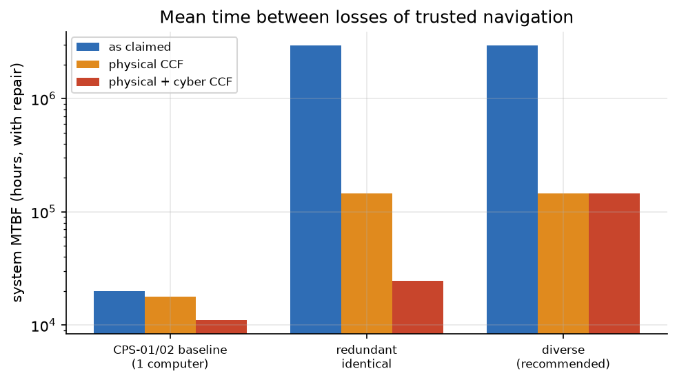

# Lesson 6 · Time, repair and a simulation that checks the algebra

> Everything so far was about one ten-hour mission with no repair. A fleet lives for years:
> components fail, are repaired and come back, and the numbers a maintenance organisation
> tracks are availability and mean time between failures, the units CPS-01 used. This lesson
> carries the common-cause model into that world with an exact Markov chain, and then does
> something every exact result in this course deserves: it checks the algebra with a
> simulation that shares none of its code.

**Code:** [`src/cyberccf/time_dependent/`](../../src/cyberccf/time_dependent/) ·
**Tests:** [`tests/test_time_dependent.py`](../../tests/test_time_dependent.py) ·
**Results:** [`validation/results/time_dependent.md`](../../validation/results/time_dependent.md) ·
**Previous:** [Lesson 5](05-redundancy-as-claimed-vs-as-it-is.md)

## Learning objectives

By the end of this lesson you should be able to:

1. Build a continuous-time Markov chain for a repairable system with common-cause events, and
   compute its availability, failure frequency, MTBF and MDT.
2. Derive the steady state of a 1-of-2 group with a beta factor by hand.
3. Use a transient solution of the same chain to cross-check a mission probability computed by
   a completely different method.
4. Design a Monte Carlo check with an honest confidence interval, and say what agreement does
   and does not prove.

---

## 1. A Markov chain over component states

The state of the system is the set of failed components; with $n$ components there are
$2^{n}$ states (256 for the navigation system with two computers). Two kinds of transition
leave a state $x$:

* **an event** $e$, at its rate $\lambda_e$, fails every *working* component it covers:
  $x \to x \cup S_e$ (if all of them are already failed, nothing happens);
* **a repair** of a failed component $j$, at rate $\mu_j = 1/T_j$ with $T_j$ its MTTR:
  $x \to x \setminus \{j\}$.

Each component has its own repair resource, as in CPS-01, and repair times are exponential.
After a common-cause event, every affected component is repaired on its own clock. That is an
assumption worth naming: a real cyber event might need one coordinated recovery (re-imaging
every unit, then re-certifying), which would make the down time longer and correlated.

The generator $G$ collects these rates (rows sum to zero). The long-run distribution solves

```math
\pi G = 0, \qquad \sum_x \pi_x = 1,
```

and the metrics follow, as in CPS-01:

```math
A = \sum_{x \text{ up}} \pi_x, \qquad \omega = \sum_{x \text{ up}} \pi_x \sum_{y \text{ down}} G_{xy}, \qquad \text{MTBF} = \frac{A}{\omega}, \quad \text{MDT} = \frac{1 - A}{\omega}.
```

$\omega$ is the frequency of up-to-down transitions; MTBF is the mean up time between system
failures and MDT the mean down time.

### By hand: a 1-of-2 group

States 0, 1 and 2 failed units. With $\lambda_i$ the independent rate of each unit,
$\lambda_{cc}$ the common-cause rate and $\mu$ the repair rate, write $a = 2\lambda_i$,
$b = \lambda_{cc}$ and $c = \lambda_i + \lambda_{cc}$ (from state 1, the working unit fails on
its own or with the common event). Balance of flow gives

```math
\pi_1 = \pi_0 \frac{a + b}{\mu}, \qquad \pi_2 = \pi_0\, \frac{b + c\,(a+b)/\mu}{2\mu}, \qquad \omega = b\,\pi_0 + c\,\pi_1 .
```

With $b = 0$ this is the binomial $\pi_2 = (\lambda/(\lambda+\mu))^2$ of two independent
units. With $b > 0$, the term $b/(2\mu)$ is **first order** in the rates while the independent
term is second order: the same asymmetry as in the mission formulas of Lesson 2, now in steady
state. The tests check this closed form against the general chain.

## 2. The navigation system with repair



| design | view | unavailability | MTBF (h) | MDT (h) |
|---|---|---|---|---|
| CPS-01/02 baseline, 1 computer | as claimed | $2.0 \times 10^{-4}$ | 19 870 | 3.99 |
| | physical + cyber CCF | $3.0 \times 10^{-4}$ | 11 130 | 3.40 |
| redundant identical, 2 computers | as claimed | $5.6 \times 10^{-7}$ | 2 959 000 | 1.67 |
| | physical CCF | $1.4 \times 10^{-5}$ | 146 500 | 1.98 |
| | physical + cyber CCF | $7.3 \times 10^{-5}$ | 24 490 | 1.79 |
| diverse (recommended) | physical + cyber CCF | $1.4 \times 10^{-5}$ | 145 100 | 1.98 |

* The first row is CPS-01's published baseline (A 0.9998, MTBF 19 870 h), reproduced exactly:
  the test compares the two implementations to $10^{-9}$.
* For the redundant design, the story of Lesson 5 holds with repair: the claimed MTBF of
  almost three million hours falls 20-fold with physical CCF and a further 6-fold with cyber
  CCF. In total it falls **121-fold**, to 24 500 hours.
* The **down time** barely moves. Common cause does not make outages longer; it makes them
  far more frequent, because a single event starts one.
* The diverse design keeps the physical-CCF figure.

## 3. Two methods, one number

The Markov chain without repair answers the mission question of Lessons 1 to 5 by a completely
different route: the probability of being down at time $t$ is

```math
P(\text{down at } t) = \sum_{y \text{ down}} \left(e^{G t}\right)_{\varnothing\, y},
```

a matrix exponential over component states. The BDD computes the same number from basic events
and a decision diagram. The two share nothing but the model description, and the tests require
them to agree to $10^{-9}$ on every navigation variant: independence, physical CCF, cyber CCF
and the shared segment.

## 4. A simulation that checks the algebra

Exact methods can be exactly wrong: a sign error in a closed form, an off-by-one in a state
index, a missed transition. A **Monte Carlo** simulation built from the model's description
alone is the classical independent check (Rausand & Høyland, 2004).

* **Missions.** Sample whether each basic event occurs (probability $1 - e^{-\lambda t}$), fail
  the components it covers, evaluate the block diagram. Two million missions, vectorised. The
  estimate gets a Wilson score interval with $z = 3$ (about 99.7 %), which behaves well for
  small proportions (Wilson, 1927).
* **Availability.** A discrete-event simulation: a priority queue of the next occurrence of
  every event and the next repair completion of every failed component. Twenty independent
  replications, each from its own seeded child generator, give a Student-t interval. The real
  rates would need simulations of billions of hours to see enough failures, so the check runs
  with every rate multiplied by 100. That changes the numbers, not the code being checked.

| check | exact | Monte Carlo [99.7 % interval] |
|---|---|---|
| missions, identical, 10 h | $4.098 \times 10^{-4}$ | $4.09 \times 10^{-4}$ [3.68, 4.54] |
| missions, diverse, 2 000 h | 0.1623 | 0.1625 [0.1617, 0.1633] |
| unavailability, identical, rates × 100 | 0.01227 | 0.0128 [0.0119, 0.0136] |
| failure frequency, diverse, rates × 100 | 0.004063 | 0.00386 [0.00358, 0.00414] |

Every check covers. What this proves is limited and worth stating precisely. Agreement shows
that the exact engines compute what the *model* says; it says nothing about whether the model
describes reality. Only data can do that, and for the cyber rates there are none.

## 5. Worked example

```python
from cyberccf.cyber_ccf_model import cyber_ccf_model
from cyberccf.independence_baseline import component_specs
from cyberccf.time_dependent import one_of_two_markov, steady_state

mttr = {n: s.mttr_hours for n, s in component_specs(mission_computers=2).items()}
ss = steady_state(cyber_ccf_model(mission_computers=2), mttr)
print(ss.mtbf, ss.mdt)  # 2.449e+04 h, 1.789 h
print(one_of_two_markov(0.98 * 2e-4, 0.02 * 2e-4 + 1.7e-5, 3.0))
# (3.19e-05, 2.12e-05): an EGI pair alone, unavailability and failure frequency
```

By hand for that EGI pair: $b = 2.1 \times 10^{-5}$ and $\mu = 1/3$, so the common-cause term
of $\pi_2$ is about $b/(2\mu) = 3.2 \times 10^{-5}$; the independent term is
$(1.96 \times 10^{-4} \times 3)^2 = 3.5 \times 10^{-7}$. Common cause carries 99 % of the
pair's unavailability.

## 6. Code walkthrough

* [`markov.py`](../../src/cyberccf/time_dependent/markov.py): `build_chain` (the generator
  over failed-component sets), `stationary`, `steady_state`, `transient_unreliability`, and
  `one_of_two_markov`.
* [`simulation.py`](../../src/cyberccf/time_dependent/simulation.py): `simulate_missions`
  with `wilson`, and `simulate_availability` (discrete-event, replications on spawned
  generators).
* The tests: the closed form, CPS-01's steady state, $e^{Gt}$ against the BDD, consistency of
  the metrics, and both simulations against the exact values.

## Exercises

1. Show that MTBF/MDT equals $A/(1-A)$, and use it to check one row of the results table.
2. In the 1-of-2 closed form, find the ratio of the common-cause and independent terms of
   $\pi_2$ to first order. When does common cause dominate?
3. Why can the discrete-event check use rates multiplied by 100, while the mission check
   uses longer missions instead? Are these two tricks the same?
4. The repair model assumes each component is repaired on its own clock after a common-cause
   event. Describe how a coordinated cyber recovery would change the chain, and which
   direction it would move the MDT.

### Solutions

1. Both are divided by the same $\omega$. Redundant identical, cyber view:
   $24490/1.789 = 13690$ and $0.9999269/0.0000731 = 13680$, equal to rounding.
2. Common-cause term $\approx b/(2\mu)$; independent term $\approx (a/\mu)(c/(2\mu)) \approx \lambda_i^2/\mu^2$
   when $b \ll \lambda_i$. The ratio is $b\mu/(2\lambda_i^2)$: common cause dominates when
   $\beta > 2\lambda_i/\mu$ roughly, i.e. when $\beta$ exceeds twice the unit's unavailability.
   That is $1.2 \times 10^{-3}$ for an EGI, so every realistic beta dominates.
3. Multiplying every rate by 100 changes the system (higher unavailability) but not the code;
   the check compares simulation and exact solution of the *same* accelerated model. A longer
   mission also changes the question asked. Both are legitimate for checking code and neither
   reproduces the real numbers.
4. Replace the individual repairs after a common-cause event by one transition back to "all
   recovered" at rate $1/T_{\text{rec}}$, which needs extra state to remember the cause. With
   $T_{\text{rec}}$ longer than the individual MTTR, the MDT grows and the availability falls;
   MTBF changes little, because it is set by how often the event occurs.

## References

* M. Rausand and A. Høyland, *System Reliability Theory*, 2nd ed., Wiley, 2004 (Markov models
  of repairable systems; simulation).
* E. B. Wilson, "Probable inference, the law of succession, and statistical inference,"
  *Journal of the American Statistical Association* 22(158), 1927 (the score interval).
* C. Moler and C. Van Loan, "Nineteen dubious ways to compute the exponential of a matrix,
  twenty-five years later," *SIAM Review* 45(1), 2003 (the matrix exponential).
* CPS-01, GMCavalheri/cyber-attack-reliability-impact-modeling (the steady-state metrics this
  lesson reproduces).
