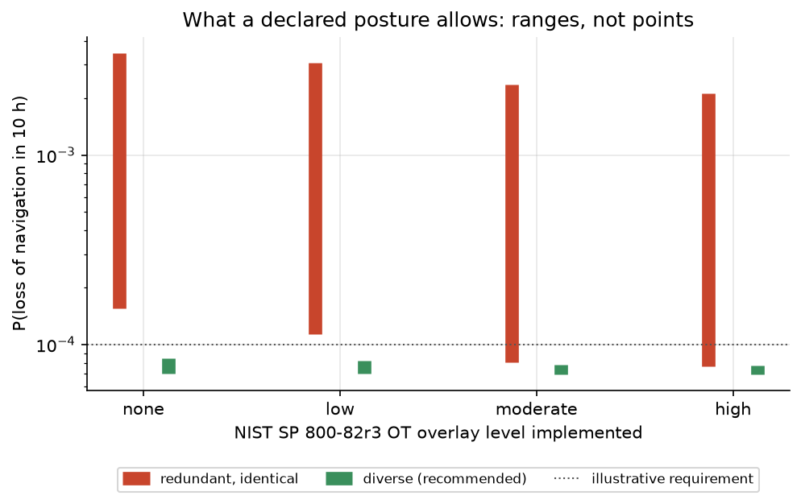

# Lesson 7 · From a security posture to a number

> Every result since Lesson 3 carried the same caveat: the cyber rates have no field data. A
> reliability engineer will ask the obvious question: "the security team says this system
> implements the NIST OT overlay at the moderate level; what beta factor does that give me?"
> This lesson builds the most honest answer available, a transparent rubric from a declared
> posture to a *range* of exposure, and finds that the answer says more about what posture
> cannot do than about what it can.

**Code:** [`src/cyberccf/security_posture/`](../../src/cyberccf/security_posture/) ·
**Data:** [`nist_overlay_controls.csv`](../../src/cyberccf/data/nist_overlay_controls.csv),
[`posture_rubric.csv`](../../src/cyberccf/data/posture_rubric.csv) ·
**Tests:** [`tests/test_security_posture.py`](../../tests/test_security_posture.py) ·
**Results:** [`validation/results/posture.md`](../../validation/results/posture.md) ·
**Previous:** [Lesson 6](06-time-repair-and-a-simulation-that-checks-the-algebra.md)

## Learning objectives

By the end of this lesson you should be able to:

1. Explain what the NIST SP 800-82 Rev. 3 OT overlay is and how it selects NIST SP 800-53
   controls by impact level.
2. Identify the overlay controls that act on each coupling factor of this project (network,
   firmware, supply chain).
3. Build a rubric that maps a posture to an interval of exposure, and propagate the interval
   through a monotone model.
4. Explain why no security posture, however strong, can substitute for design diversity
   against common cause.

---

## 1. The OT overlay

NIST SP 800-53 Rev. 5 is a catalogue of security and privacy controls. NIST SP 800-53B selects
three **baselines** from it, for systems of low, moderate and high impact. NIST SP 800-82
Rev. 3, *Guide to Operational Technology (OT) Security* (Stouffer et al., 2023), adds an **OT
overlay** in its Appendix F: a tailoring of those baselines for systems that interact with the
physical world, with controls added, removed and annotated for OT. Its Table 22 lists, for
each control, the levels that select it. All three documents are free.

The paid industrial equivalent is the ISA/IEC 62443 series, with its security levels. This
project names it and does not use it (see [`scope.md`](../scope.md)).

## 2. Controls that act on a coupling factor

The overlay has hundreds of controls. The rubric keeps those that act on one of the three
attributes that define shared vulnerabilities in Lesson 3 (transcribed from Table 22 in
[`nist_overlay_controls.csv`](../../src/cyberccf/data/nist_overlay_controls.csv)):

| attribute | controls | low | moderate | high |
|---|---|---|---|---|
| network | SC-7 boundary protection and enhancements (3), (4), (5), (21), (29) | 2 | 5 | 6 |
| firmware | CM-7 least functionality, SI-2 flaw remediation, SI-7 software and firmware integrity, with enhancements | 2 | 9 | 12 |
| supply chain | SR-3, SR-5, SR-6, SR-9, SR-10, SR-11 and enhancements | 6 | 8 | 10 |

Two rows deserve attention.

* **SC-7(29), separate subnets to isolate functions**, is *added* by the OT overlay at every
  level. Segmentation is the cheapest diversity of Lesson 4, and the overlay asks for it.
* **SC-29, heterogeneity**, the catalogue's own diversity control ("employ a diverse set of
  information technologies"), is **selected in no NIST SP 800-53B baseline** (Table 3-18) and
  does not appear in the OT overlay at all. It is listed in the data file with no level, to
  record exactly that.

## 3. The rubric

There is no published mapping from controls to failure rates, so the rubric states its
assumptions as two ranges ([`posture_rubric.csv`](../../src/cyberccf/data/posture_rubric.csv)):

* with no controls, the exposure of each attribute is anywhere from 0.25 to 10 times the
  illustrative rates of Lesson 3 (the range used throughout);
* each selected control removes a fraction $f \in [0.05, 0.25]$ of the remaining exposure of
  its attribute. With $n$ controls the exposure is multiplied by $(1-f)^{n}$.

So a level maps to an interval per attribute,

```math
\lambda_d \in \left[\, 0.25\,(1 - 0.25)^{n_d},\ \ 10\,(1 - 0.05)^{n_d} \right] \times \lambda_d^{\text{illustrative}},
```

and, because P(loss) is non-decreasing in every exposure (Lesson 3), to an interval of P(loss)
whose ends are the two corners of that box. No point estimate is ever produced. The
tests check that the levels are nested (every control at one level is at the next), that a
stronger posture never raises either end of any interval, and that the corners equal
rebuilt models.

## 4. What the rubric says



| level | β_c of an EGI | P(loss), identical design | meets $10^{-4}$ at worst | P(loss), diverse design | meets at worst |
|---|---|---|---|---|---|
| none | 0.021 to 0.46 | $1.5 \times 10^{-4}$ to $3.5 \times 10^{-3}$ | no | $7.0$ to $8.5 \times 10^{-5}$ | yes |
| low | 0.011 to 0.43 | $1.1 \times 10^{-4}$ to $3.1 \times 10^{-3}$ | no | $7.0$ to $8.2 \times 10^{-5}$ | yes |
| moderate | 0.0027 to 0.37 | $8.1 \times 10^{-5}$ to $2.4 \times 10^{-3}$ | no | $7.0$ to $7.9 \times 10^{-5}$ | yes |
| high | 0.0017 to 0.34 | $7.6 \times 10^{-5}$ to $2.1 \times 10^{-3}$ | no | $7.0$ to $7.7 \times 10^{-5}$ | yes |

Three readings.

1. **Posture moves the interval down, but does not narrow it.** For the identical design the
   interval is about 1.4 decades wide at every level. A declared posture does not tell the
   reliability engineer what $\beta_c$ is; at the high level an EGI's cyber beta factor is
   still anywhere between 0.002 and 0.34.
2. **Posture cannot remove the sharing.** Every control in the table lowers the *rate* at which
   a shared vulnerability is exploited. None changes *which* channels share it, because the
   control that would (SC-29) is in no baseline. The identical design misses the requirement at
   its worst corner at every level.
3. **Diversity makes the posture almost irrelevant.** The diverse design meets the requirement
   at every level, including with no controls at all, and its interval is less than a tenth of a
   decade wide. Its worst corner with no controls ($8.5 \times 10^{-5}$) is better than the
   identical design's worst corner at the high level ($2.1 \times 10^{-3}$) by a factor of 25.

The rubric's numbers are assumptions, and different ones would move the intervals. They would
not change the structure. Controls act on rates, diversity acts on sharing, and only sharing
creates common cause.

## 5. How to use this in a design review

* Ask the security team for the overlay level actually implemented, per attribute; the rubric
  turns that into an interval, not a number.
* If the decision changes inside the interval, the decision depends on data nobody has. Choose
  the design that does not depend on it, as in Lesson 5.
* If diversity is rejected for cost, write down the cyber beta factor the design is implicitly
  assuming, and compare it with the interval. That makes the risk accepted explicit.

## 6. Worked example

```python
from cyberccf.case_study_application import REDUNDANT
from cyberccf.security_posture import (
    controls_at,
    cyber_beta_range,
    exposure_range,
    unreliability_range,
)

print([c.control for c in controls_at("moderate", "network")])
# ['SC-7', 'SC-7(3)', 'SC-7(4)', 'SC-7(5)', 'SC-7(29)']
print(exposure_range("moderate")["network"])  # (0.0593, 7.74)
print(cyber_beta_range("moderate", 2e-4))  # (0.00266, 0.365)
print(unreliability_range(REDUNDANT, "moderate"))  # (8.055e-05, 2.367e-03)
```

By hand for the network at the moderate level: $n = 5$, so the multiplier runs from
$0.25 \times 0.75^5 = 0.059$ to $10 \times 0.95^5 = 7.74$.

## 7. Code walkthrough

* [`rubric.py`](../../src/cyberccf/security_posture/rubric.py): `load_controls` and
  `controls_at` (the transcribed table), `load_rubric`, `exposure_range`, `cyber_beta_range`
  and `unreliability_range`, which evaluates the two corners on one BDD.
* The tests spot-check the transcription against Table 22, check nesting and monotonicity, and
  check the corners against rebuilt models.

## Exercises

1. Why are the two ends of the P(loss) interval exactly the two corners of the exposure box?
   What property of the model makes that true, and what would break it?
2. Suppose a control removed 50 % of the remaining exposure instead of at most 25 %. Compute the
   firmware interval at the high level. Does the identical design now meet the requirement at
   its worst corner?
3. Draft the one paragraph a reliability engineer could add to a safety case to justify *not*
   relying on posture for common cause.
4. SC-29 is in the catalogue but in no baseline. Suggest two reasons a baseline might leave it
   out, and say what this project's results imply about that choice for redundant OT channels.

### Solutions

1. The system's failure is a monotone function of the event occurrences: the block diagram is
   coherent and an event can only fail components, never restore them. So P(loss) is
   non-decreasing in every event probability, hence in every exposure, and its minimum and
   maximum over a box sit at the all-low and all-high corners. It would break if some parameter
   could also *help*: an event that restored a component (a non-coherent model), or exposures
   that trade off against each other (moving rate from one attribute to another). Note that this
   is different from the series caveat of Proposition 6b, which is about changing *what is
   shared* at fixed marginals, not about raising a rate.
2. $f$ up to 0.5 changes only the lower end; the upper end still uses $f = 0.05$, so the worst
   corner is unchanged and the answer is no. The worst case is set by the *least* effective
   plausible control, which is the point of using a range.
3. "The design's redundancy relies on channels failing independently. Security controls in
   place reduce the rate of cyber attack but do not change the fact that both channels share
   firmware, network and supply chain, so a single successful attack defeats both. The
   achieved reliability is therefore bounded by the shared-vulnerability exposure, which
   cannot be estimated from data. Diversity of [attributes] removes this dependence."
4. Diversity is expensive to acquire, certify and maintain, and it can enlarge the attack
   surface (more products to patch). For redundant channels, though, the results here show it
   is the only control that acts on common cause; a baseline for redundant safety functions
   might reasonably select it.

## References

* K. Stouffer, M. Pease, C. Tang, T. Zimmerman, V. Pillitteri, S. Lightman, A. Hahn, S. Saravia,
  A. Sherule and M. Thompson, *Guide to Operational Technology (OT) Security*, NIST SP 800-82
  Rev. 3, September 2023 (Appendix F, Table 22).
* Joint Task Force, *Security and Privacy Controls for Information Systems and Organizations*,
  NIST SP 800-53 Rev. 5, 2020 (SC-29 heterogeneity).
* Joint Task Force, *Control Baselines for Information Systems and Organizations*, NIST SP
  800-53B, 2020 (Table 3-18).
