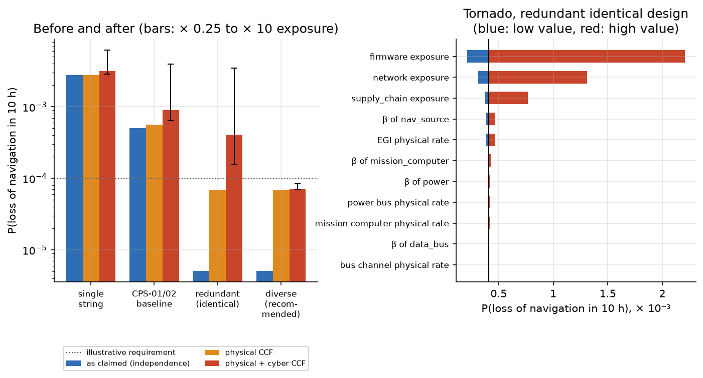

# Report: how much of redundancy's benefit survives shared cyber vulnerabilities

**Common-Cause Cyber Failure Analysis for Redundant Architectures (CPS-04)** · synthetic case
study · every number reproduced by [`validation/run_all.py`](../validation/run_all.py)

## Summary

Redundancy is valued on the assumption that redundant channels fail independently. Classical
common-cause failure (CCF) models already correct that assumption for shared *physical* causes.
This report extends the correction to shared *cyber* vulnerabilities (one firmware image, one
network segment, one supply-chain source for every channel) and applies it to the synthetic
navigation architecture of the CPS series.

* **What redundancy buys.** Going from a single-string design to one with two EGIs, two bus
  channels and two identical mission computers is claimed to cut P(loss of trusted navigation)
  549-fold (2.74 orders of magnitude). With physical CCF the cut is 40-fold (1.60 orders); with
  shared cyber vulnerabilities at the illustrative exposure, 7.7-fold (0.88 orders); at ten times
  that exposure, 1.8-fold (0.25 orders).
* **The dominant uncertainty.** The three cyber exposures out-swing every physical failure rate
  and beta factor by an order of magnitude or more in a one-at-a-time sensitivity analysis.
  Reliability engineering has no field data for them.
* **The design answer.** Diversifying each redundant pair in firmware, network segment and
  supplier keeps the physical-CCF figure ($7.1 \times 10^{-5}$ per 10-hour mission) and makes the
  result almost insensitive to the cyber exposure ($7.0$ to $8.5 \times 10^{-5}$ over a 40-fold
  range). It is the cheapest of 315 designs that meets an illustrative $10^{-4}$ requirement in the
  worst case.
* **What posture cannot do.** Controls of the NIST SP 800-82 Rev. 3 OT overlay lower the cyber
  exposure but do not change which channels share it; the catalogue's heterogeneity control
  (SC-29) is in no baseline. At every overlay level the identical design misses the requirement
  in the worst case, and the diverse design meets it.

All numbers are conditional on illustrative parameters, labelled as such, and the robust
findings are the structural ones, which the [derivation](derivation.md) proves for any
parameter values.

## 1. System and question

The system is the navigation chain of CPS-01 and CPS-02: two embedded GNSS/INS units (EGIs), each
on its own power bus, publishing on a dual-channel data bus to a mission computer fed from both
buses; a variant fits two mission computers. The function is "trusted navigation data reaches the
mission computer", and a mission lasts 10 hours. Failure rates are CPS-01's illustrative values
([parameters](../src/cyberccf/data/system_parameters.csv)); no real platform is modelled
([scope](scope.md)).

The question: how much of the reliability benefit claimed for this redundancy survives when
channels can fail together, from a shared physical cause or from a shared cyber vulnerability?

## 2. Method

1. **Independence baseline** ([Lesson 1](lessons/01-the-independence-assumption.md)). Basic
   events, a block diagram, and exact quantification by a binary decision diagram, cross-checked
   against CPS-01 and CPS-02 to $10^{-12}$.
2. **Physical CCF** ([Lesson 2](lessons/02-when-one-cause-breaks-two-channels.md)). Beta-factor
   groups on every redundant set, with beta values inside the IEC 61508-6 ranges (as quoted by a
   free source); MGL and alpha-factor models tested against NUREG/CR-5485.
3. **Cyber CCF** ([Lesson 3](lessons/03-the-cyber-beta-factor.md)). Each programmable channel
   has firmware, network and supply-chain attributes; each attribute value is one event that
   defeats every channel holding it, at an illustrative rate (attempts times success
   probability). The cyber beta factor combines with the physical one as
   $1 - \beta = (1-\beta_p)(1-\beta_c)$.
4. **Diversity and cost** ([Lesson 4](lessons/04-buying-independence.md)). 315 designs, costed
   with illustrative relative costs, compared on Pareto fronts across the exposure range.
5. **Case study, repair and posture** ([Lessons 5-7](lessons/05-redundancy-as-claimed-vs-as-it-is.md)).
   Before-and-after views, a tornado analysis, a minimax recommendation, availability and MTBF
   from an exact Markov chain checked by Monte Carlo, and a NIST posture rubric.

## 3. Results

### 3.1 Before and after



P(loss of trusted navigation) per 10-hour mission
([table](../validation/results/case_study.md)):

| design | as claimed | physical CCF | physical + cyber | over the exposure range |
|---|---|---|---|---|
| single string | $2.80 \times 10^{-3}$ | $2.80 \times 10^{-3}$ | $3.14 \times 10^{-3}$ | $2.88$ to $6.18 \times 10^{-3}$ |
| CPS-01/02 baseline (1 computer) | $5.05 \times 10^{-4}$ | $5.60 \times 10^{-4}$ | $8.99 \times 10^{-4}$ | $6.44 \times 10^{-4}$ to $3.95 \times 10^{-3}$ |
| redundant, identical | $5.09 \times 10^{-6}$ | $6.99 \times 10^{-5}$ | $4.10 \times 10^{-4}$ | $1.55 \times 10^{-4}$ to $3.46 \times 10^{-3}$ |
| diverse (recommended) | $5.09 \times 10^{-6}$ | $6.99 \times 10^{-5}$ | $7.08 \times 10^{-5}$ | $7.01$ to $8.46 \times 10^{-5}$ |

The classical independence calculation rates the redundant identical design and the diverse
design as equal. Once cyber CCF is counted they differ by a factor of 6 at the illustrative
exposure and 41 at the top of the range.

### 3.2 What redundancy buys

| model | single string / redundant identical | orders of magnitude |
|---|---|---|
| as claimed (independence) | 549 | 2.74 |
| physical CCF | 40 | 1.60 |
| physical + cyber CCF | 7.7 | 0.88 |
| physical + cyber, exposure × 10 | 1.8 | 0.25 |

Physical CCF removes 1.14 orders of magnitude of the claimed benefit; shared cyber
vulnerabilities remove a further 0.72 at the illustrative exposure and 1.35 at ten times. In the
redundant identical design, order-one cut sets of cyber origin carry 83 % of the unreliability
([cyber results](../validation/results/cyber_ccf.md)).

With repair, in CPS-01's units ([table](../validation/results/time_dependent.md)), the redundant
identical design's MTBF is 2 959 000 h as claimed, 146 500 h with physical CCF and 24 490 h with
cyber CCF; the diverse design keeps 145 100 h. The independence row of CPS-01's baseline
(A 0.9998, MTBF 19 870 h) is reproduced exactly.

### 3.3 Sensitivity

| parameter | range | swing in P(loss), redundant identical |
|---|---|---|
| firmware exposure | × 0 to × 10 | $2.0 \times 10^{-3}$ |
| network exposure | × 0 to × 10 | $1.0 \times 10^{-3}$ |
| supply-chain exposure | × 0 to × 10 | $4.0 \times 10^{-4}$ |
| beta of the EGIs | 0.005 to 0.05 | $9.0 \times 10^{-5}$ |
| EGI physical rate | × 0.5 to × 2 | $7.5 \times 10^{-5}$ |

The ranges are not like for like (physical parameters vary over the band the literature
supports, cyber exposures over two orders of magnitude because nothing supports less), and that
is the finding: the largest uncertainty is now a parameter with no data.

### 3.4 Diversity, cost and posture

* **Ranking** ([table](../validation/results/diversity.md)). With any non-zero exposure, splitting
  network segments buys the most reliability per cost unit and a third identical EGI the least.
  The ranking among diversity items does not move with the overall exposure level (each benefit
  scales with it); what moves is the choice between diversity and more identical hardware. At ten
  times the exposure, diversifying the EGIs beats a second identical mission computer for the same
  budget.
* **Recommendation.** The cheapest design meeting $10^{-4}$ at the worst case (exposure × 10) is
  two EGIs and two mission computers, each pair diverse in firmware, segment and supplier
  (relative cost 85).
* **Posture** ([table](../validation/results/posture.md)). At the high overlay level the
  identical design's P(loss) still spans $7.6 \times 10^{-5}$ to $2.1 \times 10^{-3}$ and misses
  the requirement at its worst corner; the diverse design meets it at every level, with no
  controls at all included.

## 4. Verification

Every result comes from code tested against closed forms, published equations or independent
oracles (282 tests, 99.8 % branch coverage): NUREG/CR-5485 Eqs. 5.5-5.11 and Tables 5-4 and 5-5;
CPS-01 and CPS-02 v1.0.0; brute-force enumeration and exhaustive BDD truth tables; a Markov
chain's $e^{Gt}$ against the BDD; Monte Carlo simulations within their 99.7 % intervals; and the
eight propositions of the [derivation](derivation.md), each checked numerically
([checks](../validation/results/reduction_checks.md)). CI reruns every validation script and
fails if any committed table changes.

## 5. Limitations

1. **Cyber parameters have no field-data basis.** The exposure rates, the rubric weights and the
   costs are illustrative. Every conclusion that depends on them is shown across a range; the
   conclusions stated in the summary are those that hold across it.
2. **Per-value rates.** A shared vulnerability's rate does not grow with the number of holders.
   This conserves each component's exposure and makes architectures comparable; if attack rates
   grow with attack surface, merging attribute values is penalised (Lesson 3 shows one result
   moving with this choice).
3. **Independent, all-or-nothing events.** Distinct attribute values carry independent events (the
   optimistic end of the design-diversity literature), events defeat every holder fully, and
   attackers do not choose their timing.
4. **Repair.** Exponential, independent repair after a common-cause event; a coordinated cyber
   recovery would lengthen down time.
5. **Scope.** One failure mode: several channels defeated at once because they share something.
   Attacks on one channel and data corruption without loss are other projects (CPS-01, CPS-03).
   This is not a complete cyber risk model and not an assessment of any real system.

## 6. Conclusions

1. On a representative redundant architecture, the classical independence claim overstates what
   redundancy buys by about two orders of magnitude once both kinds of common cause are counted;
   physical CCF accounts for a little more than half of that in log terms, and shared cyber
   vulnerabilities for the rest.
2. The correction enters the calculation reliability engineers already do: the effective beta
   factor $1 - (1-\beta_p)(1-\beta_c)$, and the best any identical redundancy can buy, $1/\beta$.
3. Diversity is never worse for a redundant group (proved) and, here, it turns the least known
   parameter of the system into one that barely matters. That is a decision a design review can
   make without knowing the cyber exposure.
4. Security posture lowers the exposure but cannot remove the sharing; only design diversity
   does.

## Reproduction

```bash
uv sync
uv run python validation/run_all.py
uv run python notebooks/build_notebooks.py
```

Related work and the novelty statement: [`related-work.md`](related-work.md). The course:
[`lessons/`](lessons/).
